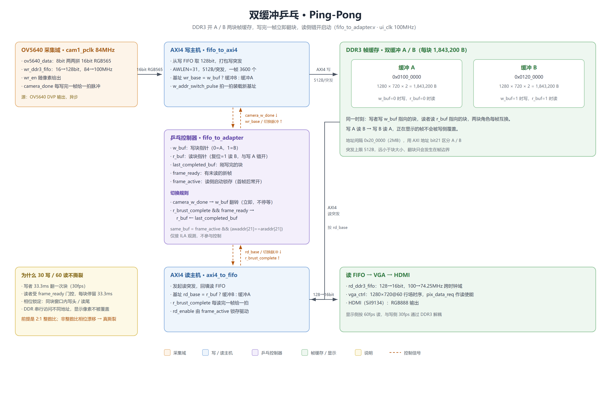

# FPGA 工程合集

同一块野火升腾Pro（Xilinx Artix-7 `xc7a200tfbg484-2`）上的三个 Vivado 2018.3 工程，按目录分开，各自带源码、约束、仿真，互不依赖。

## 收录的工程

| 目录 | 工程 | 数据通路 | README |
| --- | --- | --- | --- |
| [single_buffer/](single_buffer/) | 单缓存版 | OV5640 → DDR3 单缓冲 → HDMI，运动画面有水平接缝 | [README](single_buffer/README.md) |
| [double_buffer/](double_buffer/) | 双缓存乒乓版 | OV5640 → DDR3 双缓冲 A/B → HDMI，接缝消除 | [README](double_buffer/README.md) |
| [gigabit_ethernet/](gigabit_ethernet/) | 千兆以太网协议栈 | RGMII / ARP / IP / ICMP / UDP，纯 RTL，零 IP 依赖 | [README](gigabit_ethernet/README.md) |

前两个是 1280×720@30 RGB565 采集、DDR3 帧缓存、SiI9134 输出 1280×720@60；第三个用同一块板子的 RGMII 网口，不做图像采集。

单缓存版另有独立仓库 [hk-2001/ov5640_ddr3_hdmi_single](https://github.com/hk-2001/ov5640_ddr3_hdmi_single)，这里收录的是它 `main` 分支的快照，两处内容以独立仓库为准。

`gigabit_ethernet/` 没有 `.xci`，其余两个工程各自带 IP 配置；

## 单缓存与双缓存的差别

双缓存版只在单缓存版基础上改了 DDR3 侧的乒乓控制器 `rtl/ddr3/fifo_to_adapter.v`，时钟树、复位树、IP 配置、约束、摄像头、HDMI 和顶层连线都没动。

| 对比项 | 单缓存 | 双缓存乒乓 |
| --- | --- | --- |
| DDR3 帧缓存 | 1 块（1,843,200 B） | A / B 两块，各 1,843,200 B |
| 基址 | 单块起始 | `0x0100_0000` / `0x0120_0000` |
| 读写关系 | 读写同一块，无握手 | 写 A 读 B / 写 B 读 A，按帧翻转 |
| 运动画面 | 水平接缝，位置不固定 | 接缝消除 |
| 改动范围 | 基准工程 | 只改 `fifo_to_adapter.v` |
| 代价 | 无 | 多占一帧 DDR3 空间 |

单缓存的接缝来自写端写满一帧后从头覆盖、读端还在按自己的节奏读到画面中部，上下半屏分属两帧，接缝位置因此一直漂。双缓存让正在显示的帧不会被写侧覆盖，接缝就没了。同步交换时机与三缓存的改进方向见 [double_buffer/README.md](double_buffer/README.md)。



## 目录结构

三个工程的目录结构一致：

```
<工程名>/
├── README.md
├── LICENSE
├── create_project.tcl
├── .gitignore / .gitattributes
├── constrs/                  引脚约束 + CDC 约束
├── rtl/                      Verilog 源码
├── ip/                       IP .xci（gigabit_ethernet 无此项）
├── sim/                      仿真 TB
├── docs/images/              架构图 / 时钟树 / 复位树
├── IO/                       开发板引脚映射
└── DEBUG/                    上板实拍、ILA 截图
```

## LICENSE

各工程目录下各有自己的 `LICENSE`，均为 MIT。
