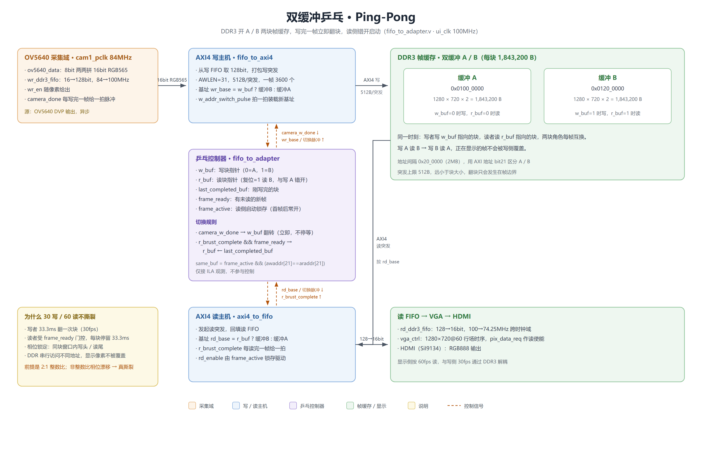

# FPGA 工程合集

三个 Vivado 2018.3 工程，跑在同一块野火升腾 Pro 上，芯片是 Xilinx Artix-7 `xc7a200tfbg484-2`。按目录分开，各自带源码、约束和仿真，互不依赖。

## 项目一：[single_buffer/](single_buffer/) 单缓存版

OV5640 采集 1280×720@30 RGB565，经 DDR3 单帧缓存，SiI9134 输出 1280×720@60 HDMI。运动画面有水平接缝，位置不固定。另有独立仓库 [hk-2001/ov5640_ddr3_hdmi_single](https://github.com/hk-2001/ov5640_ddr3_hdmi_single)，这里收录的是它 `main` 分支的快照，两处内容以独立仓库为准。[README](single_buffer/README.md)

## 项目二：[double_buffer/](double_buffer/) 双缓存乒乓版

数据通路跟项目一一样，只改了 DDR3 侧的乒乓控制器 `rtl/ddr3/fifo_to_adapter.v`。时钟树、复位树、IP 配置、约束、摄像头、HDMI 和顶层连线都没动。DDR3 里放 A/B 两块帧缓存，各 1,843,200 B，基址 `0x0100_0000` / `0x0120_0000`，写 A 读 B、写 B 读 A，按帧翻转。单缓存的接缝是写端写满一帧从头覆盖、读端还在按自己的节奏读到画面中部，上下半屏分属两帧，所以接缝位置一直漂。乒乓版让正在显示的帧不被写侧覆盖，接缝就没了，代价是多占一帧 DDR3 空间。交换时机和三缓存的改进方向写在 [double_buffer/README.md](double_buffer/README.md) 里。

## 项目三：[gigabit_ethernet/](gigabit_ethernet/) 千兆以太网协议栈

用同一块板子的 RGMII 网口，不做图像采集。RGMII / ARP / IP / ICMP / UDP 都是纯 RTL，没有 `.xci`，不依赖 IP 核。另外两个工程各自带 IP 配置。[README](gigabit_ethernet/README.md)
