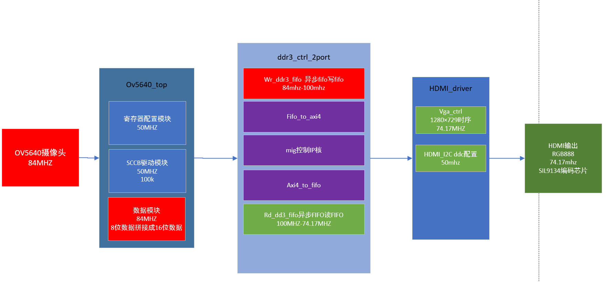

# 基于 DDR3 的双缓冲视频直通系统

## 项目简介
在单缓存版基础上完成的双缓冲视频管道，独立设计基于 AXI4 总线的乒乓缓冲控制器，将 OV5640 摄像头画面写入 DDR3，再由 HDMI 稳定输出。相对单缓存只改了 DDR3 侧一层，把单缓冲换成 A/B 两块乒乓，画面撕裂消除。已上板验证，摄像头 30fps 写入、HDMI 60fps 读出稳定。

### **视频缓存架构图**


#### [复位架构图](docs/images/reset_tree.png)
#### [时钟架构图](docs/images/clock_tree.png)

## 关键成果
- **画面稳定无撕裂**：写 A 读 B、写 B 读 A 按帧翻转，正在显示的帧不被写侧覆盖，单缓存那种横贯画面的水平接缝消失。
- **板级帧率实测**：频率计测出摄像头 30FPS、HDMI 60FPS。
- **改动范围小**：只改 `rtl/ddr3/fifo_to_adapter.v`，时钟树、复位树、IP 配置、约束、摄像头、HDMI 和顶层连线都没动。
- **时序收敛**：`cam1_pclk` 单独异步分组，带 0.5ns setup uncertainty，时序通过。

## 技术亮点
- **乒乓缓冲控制器**：`ui_clk`（MIG 100MHz）域维护 `w_buf` / `r_buf` / `last_completed_buf` / `frame_ready`。写侧 `camera_w_done` 当拍翻块不等读者，读侧在 `r_brust_complete && frame_ready` 时切到刚写完的块；复位时写 A 读 B 错开。
- **AXI4 读写主机**：`fifo_to_axi4` / `axi4_to_fifo` 手写 AXI4 突发，一次 512 B（32 拍 × 16 B），一帧 3600 次突发；A/B 基址 `0x0100_0000` / `0x0120_0000`，各 1,843,200 B。
- **跨时钟域处理**：`wr_ddr3_fifo` 写侧 84MHz、读侧 100MHz，顺带完成 16→128bit 位宽转换；`rd_ddr3_fifo` 从 100MHz 回到 74.25MHz 显示时钟。
- **异步复位同步释放**：用 `xpm_cdc_async_rst` 给每个时钟域生成复位，原语自带 `ASYNC_REG`。读写 FIFO 单独走一路，`sys_init_done` 之后再数 1024 拍才释放。
- **ILA 在线调试**：乒乓信号加 `mark_debug`，抓 `w_buf / r_buf / frame_ready / same_buf`；`same_buf` 只看基址 bit21 是粗标志，配合 awaddr/araddr 在窗口入口的相位判断是否真冲突。

## 文件说明
- `rtl/`：核心 RTL 代码

### 顶层与乒乓核心
#### [双缓存视频顶层](rtl/top/ov5640_ddr_hdmi.v)
#### [乒乓控制器与 AXI4 适配](rtl/ddr3/fifo_to_adapter.v)
#### [FIFO 转 AXI4 写主机](rtl/ddr3/fifo_to_axi4.v)
#### [AXI4 转 FIFO 读主机](rtl/ddr3/axi4_to_fifo.v)
#### [DDR3 双口封装](rtl/ddr3/ddr3_ctrl_2port.v)

### 摄像头与显示
#### [OV5640 采集顶层](rtl/camera/ov5640_top.v)
#### [DVP 数据拼接](rtl/camera/ov5640_data.v)
#### [SCCB 配置](rtl/camera/ov5640_cfg.v)
#### [HDMI 输出顶层](rtl/hdmi/hdmi_drvier.v)
#### [VGA 时序](rtl/hdmi/vga_ctrl.v)
#### [SiI9134 配置](rtl/hdmi/hdmi_cfg.v)

### 时钟、复位与仿真
#### [跨时钟域复位同步](rtl/xpm_cdc/xpm_rst_sync.v)
#### [频率/帧率计](rtl/freq_meter/freq_meter.v)
#### [引脚约束](constrs/ov5640_ddr3_hdmi_full_fixed.xdc)
#### [CDC 约束](constrs/diag_cdc.xdc)
#### [系统级仿真 TB](sim/tb_system.v)

## 调试记录：闪屏问题排查

### 故障现象
单缓存整链路和双缓存交替地址的仿真都通过了，上板却出现画面错乱、不断闪屏。[闪屏 BUG 现象视频](<DEBUG/上板问题/闪屏BUG现象视频-FIFO溢出-.mp4>)，定位过程记在[闪屏 BUG 调试记录](<DEBUG/上板问题/闪屏BUG调试记录.docx>)。

### 问题分析
问题出在写侧多了一个"等读者读完再写"的门控：

```verilog
wire wr_start_allow = ~frame_ready;
