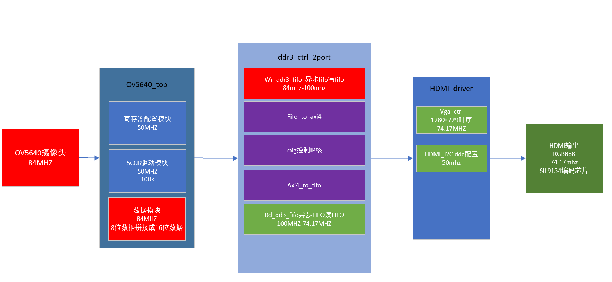
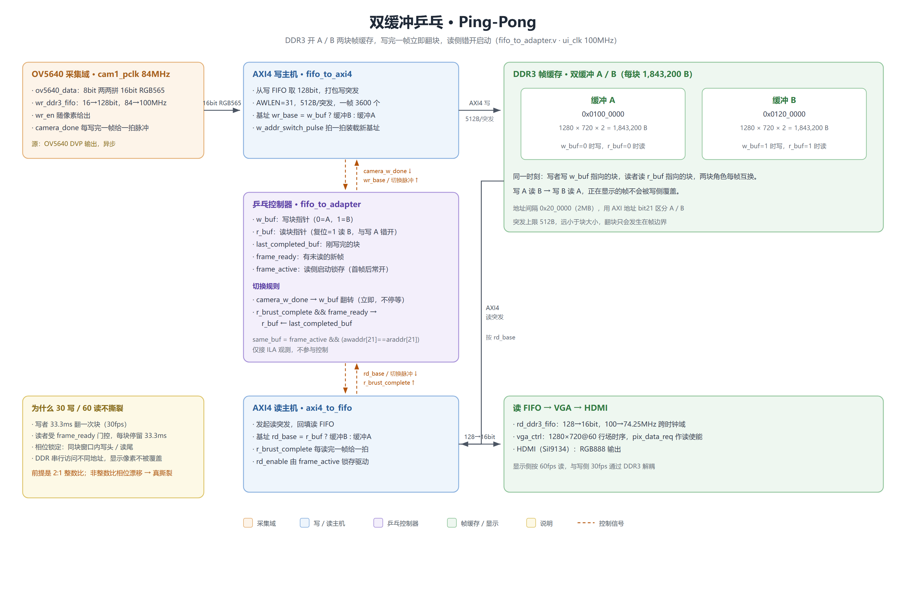
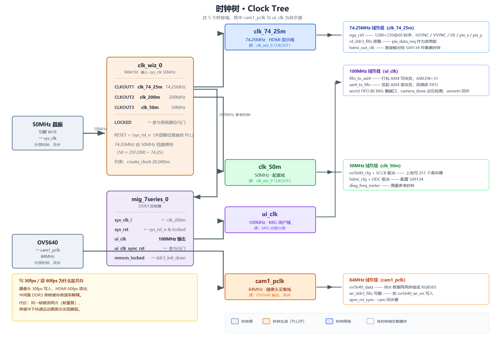
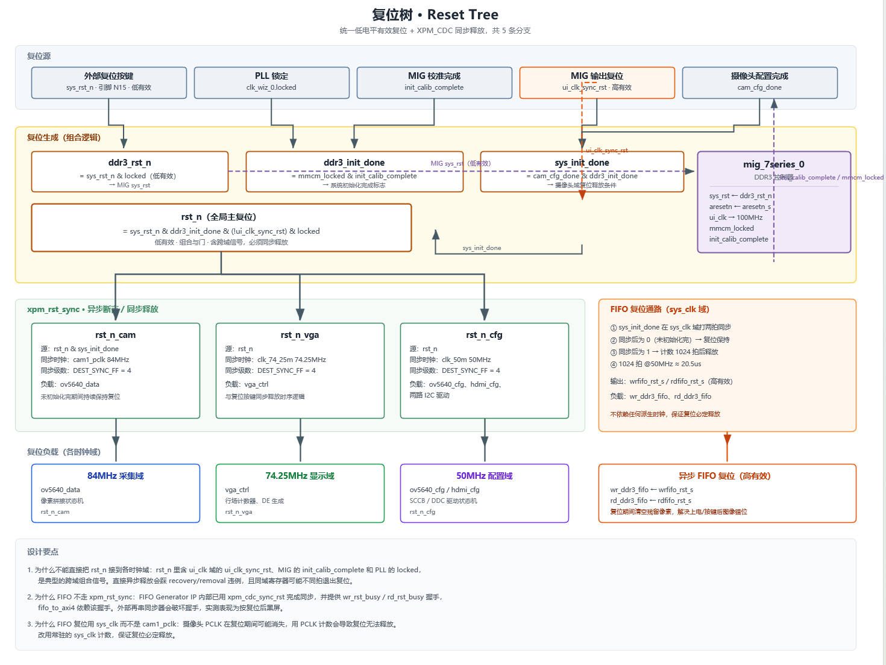

# OV5640 + DDR3 + HDMI 双缓存乒乓显示

在单缓存版基础上改的，只动了 DDR3 侧的乒乓控制器，单缓冲换成双缓冲 A/B 乒乓，画面撕裂消除了。但原因跟"双缓冲一定不撕"的直觉不太一样，"为什么 30/60 不撕裂"和"已知问题"两节会说清楚。

## 实拍

[双缓存实时显示，图像撕裂已消除（mp4）](<DEBUG/双缓存实时显示拍摄视频 图像撕裂已消除.mp4>)

手持摄像头对准桌面实时采集，经 DDR3 双缓冲帧缓存后送 HDMI。镜头晃动时画面整体跟随，没有单缓冲那种横贯画面的水平接缝。

单缓冲的接缝是这么来的：写端写满一帧后从头覆盖下一帧，读端按自己的节奏读到画面中部时，写指针已经回卷，上下半屏分别来自两帧。下面这张 ILA 抓的就是读写指针错位的瞬间。


板级频率计实测：摄像头 30FPS、HDMI 60FPS。

## 系统规格

| 项目 | 参数 |
|---|---|
| FPGA | Xilinx Artix-7 xc7a200tfbg484-2 |
| 工具版本 | Vivado 2018.3 |
| 摄像头 | OV5640，1280×720，RGB565，30 fps |
| 输入接口 | DVP 8bit（pclk / vsync / href / data[7:0]） |
| 配置接口 | SCCB（兼容 I2C），上电写 251 个寄存器 |
| 帧缓存 | DDR3，MIG 7-series，32bit 数据总线，**双缓冲 A/B 两块** |
| 显示输出 | HDMI 1280×720 @ 60 fps |
| 显示芯片 | SiI9134，经 DDC（I2C）配置 |
| 系统时钟 | 50 MHz 板载晶振（引脚 W19） |

## 系统架构



数据流向：OV5640 采集 → 写 FIFO 跨时钟域 → AXI4 写突发进 DDR3 → AXI4 读突发回填读 FIFO → 跨回显示时钟 → VGA 时序送 HDMI。

几个关键节点：

- **ov5640_data** 把 DVP 的 8bit 数据两两拼成 16bit 的 RGB565，同时给出写使能
- **wr_ddr3_fifo** 做第一次跨时钟域，写侧 84MHz、读侧 100MHz，顺带完成 16bit→128bit 的位宽转换
- **fifo_to_adapter** 双缓存的核心层：乒乓控制器 + 两个 AXI4 主机（写 `fifo_to_axi4`、读 `axi4_to_fifo`），基址由 `w_buf`/`r_buf` 译码给出
- **rd_ddr3_fifo** 第二次跨时钟域，从 100MHz 回到 74.25MHz 的显示时钟
- **vga_ctrl** 生成 1280×720@60 的行场时序，顺便给出读请求

配置通路独立跑在 50MHz：摄像头走 SCCB（16bit 寄存器地址），SiI9134 走 DDC（8bit 地址），两条共用同一套 I2C 驱动逻辑，各自例化一份。

双缓冲相对单缓冲，改动全部集中在 `fifo_to_adapter.v` 一层。FIFO 和 AXI4 主机之间多了一个乒乓控制器，把"读写同一块"改成"写 A 读 B / 写 B 读 A"来回切：



## 双缓存乒乓方案

控制器在 `ui_clk`（MIG 100MHz）域里维护 `w_buf`（写哪块）、`r_buf`（读哪块）、`last_completed_buf`（刚写完的块）、`frame_ready`（有没有新帧待读）。写和读拆成独立的 always 块：

```verilog
// 控制块：记录刚写完的块 / 新帧就绪 / 读侧启动锁存
always @(posedge ui_clk or posedge reset) begin
    if (reset) begin
        last_completed_buf <= 1'b0;  frame_ready <= 1'b0;  frame_active <= 1'b0;
    end else if (camera_w_done) begin
        last_completed_buf <= w_buf;   // 记下刚写完的块
        frame_ready        <= 1'b1;    // 通知读侧：有新帧
        frame_active       <= 1'b1;    // 启动读侧（锁存，常开）
    end else if (r_brust_complete && frame_ready) begin
        frame_ready <= 1'b0;           // 读侧已消费新帧
    end
end

// 写侧：camera_w_done 当拍立即翻 w_buf（不等等读者）
always @(posedge ui_clk or posedge reset) begin
    if (reset) begin
        w_buf <= 1'b0;                 // 初始写 A
    end else if (camera_w_done) begin
        w_buf <= ~w_buf;               // 立即切换写缓冲
        w_addr_switch_pulse <= 1'b1;
    end
end

// 读侧：读到新帧且就绪时，切到刚写完的块；初始归 B，与写 A 错开
always @(posedge ui_clk or posedge reset) begin
    if (reset) begin
        r_buf <= 1'b1;                 // 初始读 B（与写 A 错开）
    end else if (r_brust_complete && frame_ready) begin
        r_buf <= last_completed_buf;   // 切到刚写完的块
        r_addr_switch_pulse <= 1'b1;
    end
end

// 仅供 ILA 观测：读写落在同一 2MB 块
wire same_buf = frame_active && (m_axi_awaddr[21] == m_axi_araddr[21]);
```

写侧在 `camera_w_done` 当拍就翻 `w_buf`，不等读者，这一点是"闪屏问题"一节里踩过坑之后定下来的。读侧复位归 B（`r_buf=1`），跟写 A 错开，避免一开始读写就撞同一块。

双缓存交替地址的仿真波形：


### 乒乓如何消除撕裂

`same_buf=1` 只表示读写落同一块，不等于地址冲突，它只看基址 bit21，分不清块内位置。

乒乓控制器每写完一帧就把写缓冲切到另一块，同时帧就绪后把读缓冲切到刚写完的那块。写侧永远在写一块、读侧永远在读另一块，正在显示的帧不会被写侧覆盖，因此消除了单缓存的水平接缝。写/读缓冲的翻转分别由 `camera_w_done`（写）和 `r_brust_complete && frame_ready`（读）驱动，两个过程各自独立。

板级实测下，摄像头 30FPS、HDMI 60FPS 时显示稳定、无撕裂；用 ILA 抓 `same_buf` 上升沿可确认，每次块翻转前后读写始终落在不重叠的块区。

## 时钟域



整块设计一共 5 个时钟域，其中 `cam1_pclk` 来自摄像头、`ui_clk` 来自 MIG，都不是本时钟系统（clk_wiz_0）产生的，属于真正的异步源。

| 时钟 | 频率 | 来源 | 主要负载 |
|---|---|---|---|
| `sys_clk` | 50 MHz | 板载晶振 W19 | clk_wiz_0 输入 |
| `clk_74_25m` | 74.25 MHz | PLL CLKOUT1 | vga_ctrl、rd_ddr3_fifo 读侧、hdmi_out_clk |
| `clk_200m` | 200 MHz | PLL CLKOUT2 | MIG 参考时钟 |
| `clk_50m` | 50 MHz | PLL CLKOUT3 | SCCB / DDC 配置、频率计 |
| `cam1_pclk` | 84 MHz | 摄像头输出 | ov5640_data、wr_ddr3_fifo 写侧 |
| `ui_clk` | 100 MHz | MIG 输出 | AXI4 读写两端 + 乒乓控制器 |

约束上把 `cam1_pclk` 单独异步出去（双缓存新增的乒乓控制器全在 `ui_clk` 域，不引入新的跨时钟问题）：

```tcl
create_clock -period 11.905 -name cam1_pclk [get_ports cam1_pclk]
set_clock_groups -asynchronous \
    -group [get_clocks -include_generated_clocks sys_clk] \
    -group [get_clocks -include_generated_clocks cam1_pclk]
```

`cam1_pclk` 没走专用时钟引脚（AA21，普通 IO），所以约束里带了 `set_property CLOCK_DEDICATED_ROUTE FALSE [get_nets cam1_pclk_IBUF]`——这块板子的摄像头接口就是这么连的，代价是时钟抖动比专用引脚差。另外按实测频率（84,000,064 Hz）设了 0.5ns 的 setup uncertainty 给抖动留余量。

## 复位设计

这是整个项目里最绕的部分，时钟和复位设计跟单缓存版完全一致，双缓存没动，单独画了一张图。



### 问题

最开始的写法是把复位做成一个组合与门，直接扇出到三个时钟域：

```verilog
assign rst_n = sys_rst_n & ddr3_init_done & (!ui_clk_sync_rst) & locked;
```

下面各模块清一色 `always @(posedge clk or negedge rst_n)`——这是异步释放。风险有两个：释放沿可能落在目标时钟的建立/保持窗口里导致 recovery/removal 违例；同域内不同寄存器可能不是同一拍退出复位，状态机初值不一致。

### 解法

用 Xilinx 的 `xpm_cdc_async_rst` 原语（异步断言、同步释放）给每个时钟域各生成一份：

```verilog
xpm_cdc_async_rst #(
    .DEST_SYNC_FF   (4),
    .INIT_SYNC_FF   (0),
    .RST_ACTIVE_HIGH(0)     // 本项目 rst_n 为低有效
) u_rst_sync_cam (
    .src_arst (cam_rst_src),
    .dest_clk (cam_clk),
    .dest_arst(rst_n_cam)
);
```

选原语而不是手写两级 FF，是因为它自带 `ASYNC_REG` 属性，布局时会把同步寄存器放紧邻，亚稳态概率比手写低；时序约束也由原语自带，不用再手写 `set_false_path`。

采集域（`rst_n_cam`）额外串了一个条件：`cam_rst_src = rst_n & sys_init_done`。摄像头没配置完之前，采集端一直按着复位不放——配置过程中摄像头输出的数据是乱的，与其接收了再丢，不如从源头卡住。

### FIFO 单独走一路

读写两个异步 FIFO **没有**接上面这三条复位。原因是 FIFO IP 内部已经做了复位同步，外面再串一级同步会破坏它的 busy 握手时序。

这两个 FIFO 的复位由顶层自己生成：`sys_init_done` 打两拍同步到 50MHz，确认为 0（未初始化完成）就保持复位；确认为 1 之后再数 1024 拍才释放。多等这 1024 拍是为了让 DDR3 读写通路彻底稳定，避免第一帧写入时控制器还没准备好。

```verilog
always @(posedge sys_clk or negedge sys_rst_n) begin
    if (!sys_rst_n) begin
        fifo_rst_cnt <= 10'd0 ;
        fifo_rst_sys <= 1'b1  ;          // 复位期间保持复位
    end
    else if (!sys_init_done_s) begin
        fifo_rst_cnt <= 10'd0 ;
        fifo_rst_sys <= 1'b1  ;          // 还没配置好 → 一直清
    end
    else if (fifo_rst_cnt != 10'd1023) begin
        fifo_rst_cnt <= fifo_rst_cnt + 1'b1;
        fifo_rst_sys <= 1'b1  ;          // 配置好后再保持 1024 拍
    end
    else begin
        fifo_rst_sys <= 1'b0  ;          // 释放
    end
end
assign wrfifo_rst_s = fifo_rst_sys ;
assign rdfifo_rst_s = fifo_rst_sys ;
```

## 关键参数

| 量 | 值 |
|---|---|
| 一帧大小 | 1,843,200 B（1280×720×2） |
| AXI 突发 | 512 B（32 拍 × 16 B） |
| 一帧突发数 | 3600 |
| A 区基址 | `0x0100_0000` |
| B 区基址 | `0x0120_0000` |
| 写 FIFO 深度 | 2048 像素（闪屏根因） |
| 读 FIFO 深度 | 2048 像素 |
| 写带宽 | 55.3 MB/s |
| 读带宽 | 110.6 MB/s |

## ILA 验证不撕裂

`same_buf` 只是个粗标志，要证明地址不冲突，得上板用 ILA 看真实地址：

1. 触发条件设 `same_buf` 上升沿（0→1），正好卡住"两块变同块"的瞬间，撕裂只会从这里开始。
2. 触发后看 `m_axi_awaddr`（写地址）和 `m_axi_araddr`（读地址）在窗口入口处的值：
   - 安全：awaddr 在块基址附近（写者刚翻进这块、从头部写），araddr 在块尾附近（读者已读完整帧、停在尾巴），头尾分离。
   - 危险：awaddr 和 araddr 都贴近块基址，写读同块同头，这才是真撕。
3. 多抓几次，只要每次入口都是写头读尾，就说明当前 30/60 锁定下确实不冲突。

有一点容易误判：别直接挂 `same_buf && (awaddr >= araddr)` 当撕裂标志。读者每 60fps 会把 araddr 从块尾绕回块头重读一遍，那一刻写在中、读在头，awaddr > araddr 会误报。所以看窗口入口相位比逐拍比地址靠谱。

乒乓控制器信号都加了 `(* mark_debug = "true" *)`，综合后 `Tools → Set Up Debug` 直接挂 ILA 看 `w_buf / r_buf / frame_ready / same_buf`。板上抓的 ILA 截图放在 `DEBUG/ILA/`。

## 闪屏问题

单缓存整链路和双缓存交替地址机制仿真都通过了，上板却出现画面错乱、不断闪屏。现象录在[闪屏 BUG 现象视频（FIFO 溢出）](<DEBUG/上板问题/闪屏BUG现象视频-FIFO溢出-.mp4>)，定位过程记在[闪屏 BUG 调试记录](<DEBUG/上板问题/闪屏BUG调试记录.docx>)。

### 现象与定位

问题出在写侧多了一个"等读者读完再写"的门控：

```verilog
// fifo_to_adapter.v —— bug 本体
wire wr_start_allow = ~frame_ready;

// fifo_to_axi4 —— IDLE 出口被门控卡住
if (wr_ddr3_req == 1 && wr_start_allow == 1)
    next_state = S_WR_ADDR;
```

`camera_w_done` 到来后 `frame_ready` 置 1，`wr_start_allow` 随之变 0，写主机卡在 `S_IDLE` 不再发起突发，一直等到 `r_brust_complete`（读者读完一帧，约 8.3ms）。这段时间摄像头照常灌像素：27.6 Mpx/s × 8.3ms ≈ 229,000 个像素，而写 FIFO 只能装 2048 个。84MHz 下 FIFO 24~49μs 就填满，这次停顿是预算的 340 倍，必然溢出 → 本帧数据整体错位 → 闪屏。

### 仿真为什么没抓到

仿真 TB 做了反压：检测到 `full` 就把摄像头写使能拉低、不再往里写，所以 FIFO 永远不会溢出。实际代码里没有反压，摄像头会一直输出数据。而 HDMI 消耗数据的速率本来就比摄像头写快，只要写侧不停等，FIFO 根本不会溢出——仿真和板子的差别就在这个假设上。

### 修复

取消写侧一切"停下来等"的门控：

```verilog
wire wr_start_allow = 1'b1;   // 永不停等
```

`camera_w_done` 后立刻切 `w_buf`，写主机接着写下一块，不等读者释放。改完画面恢复正常，就是开头那段实时显示视频的效果。

## 目录结构

```
OV5640_DDR3_HDMI_DOUBLE_BUFFER/
├── README.md                 ← 本文件
├── create_project.tcl        ← 一键重建 Vivado 工程
├── .gitignore / .gitattributes / LICENSE
├── constrs/                  ← 引脚约束 + CDC 伪路径
├── rtl/                      ← Verilog 源文件（按功能分子目录）
│   ├── top/                  ← 顶层集成
│   ├── camera/               ← OV5640 采集 + SCCB 配置
│   ├── ddr3/                 ← 双缓存核心（乒乓控制器 + 读写主机 + MIG 封装）
│   ├── hdmi/                 ← SiI9134 配置 + VGA 时序
│   ├── freq_meter/           ← 频率/帧率计（调试用）
│   └── xpm_cdc/              ← 跨时钟域复位同步
├── ip/                       ← IP .xci（MIG / clk_wiz / FIFO）
├── sim/                      ← 系统级仿真 TB + 波形配置/波形库
├── docs/images/              ← 设计图（架构 / 时钟树 / 复位树 / 乒乓）
├── IO/                       ← 开发板引脚映射表
└── DEBUG/                    ← 实拍视频、ILA/仿真截图、闪屏调试记录
```

`ov5640_ddr3_hdmi_new.xpr` 不入库：`.xpr` 写死了生成它的机器的绝对路径，换电脑打不开，统一用 `create_project.tcl` 重建。

## 快速开始

### 1. 重建工程

```bat
cd <本仓库目录>
vivado -mode batch -source create_project.tcl
```

脚本用 `[file dirname [info script]]` 动态算根目录，放哪都能跑。建好工程、加完源文件与约束、配好 IP 后，在 Vivado 里综合 → 实现 → 生成比特流即可。

### 2. 综合 / 实现

```bat
launch_runs synth_1 -jobs 4
wait_on_run synth_1
launch_runs impl_1 -to_step write_bitstream -jobs 4
wait_on_run impl_1
```

### 3. 上板前确认

- `rtl/hdmi/vga_ctrl.v` 打开 `` `define Resolution_1280x720 ``（仿真用的 `Resolution_1280x2` 上板不出图）
- 顶层 `COLOR_TEST` 默认 `0`（正常显示）；置 `1` 输出 8 色彩条，用来二分定位问题
- 乒乓控制器信号已加 `(* mark_debug = "true" *)`，综合后 `Tools → Set Up Debug` 可以直接挂 ILA

### 4. 仿真

`sim/` 里是系统级 TB `tb_system.v`，以及波形配置 `tb_system_behav.wcfg` 和抓好的波形库 `tb_system_behav.wdb`。

把 `tb_system.v` 加进仿真文件集 `sim_1`，顶层选 `tb_system` 直接 Run Simulation。`.wcfg` 只存信号列表、不绑定仿真库，要在仿真跑起来之后从波形窗口 `File → Open Waveform Configuration` 载入；仿真没运行时直接打开会报 `Cannot locate target loader`，属正常现象。

## 关于同步交换与三缓存

本工程的乒乓双缓冲已经消除了单缓存的撕裂，但它属于"写完即翻、读写独立翻转"的简化乒乓：写侧在 `camera_w_done` 当拍就翻块，不等待读侧释放。在固定且成整数倍的读写帧率比下这种简化是安全的（上一节的板级实测即如此）；当读写速率比任意、或二者之间存在漂移时，乒乓方案的交换时机就成了异步系统的通用难点。更鲁棒的两种办法：

- **同步交换（synchronized swap）**：让写侧在翻块前等待读侧已经释放当前块（例如用 `frame_ready` / 读完成握手），保证读侧永远不在写侧要回写的块上。这是把交换时机绑定到消费完成，而不是生产完成。
- **三缓存（triple buffering）**：再加一块缓冲，使生产者永远有一块空闲缓冲可写、消费者永远读完整的一帧，二者彻底解耦。代价是 +2MB DDR3 空间、显示延迟 +1 帧。

三缓存本质是多用一块缓冲，把"生产者零阻塞"和"消费者永远读完整帧"同时保证，不需要依赖固定的速率比。对摄像头 → DDR3 → HDMI 这类"生产者（sensor）与消费者（显示器）速率不完全同步"的链路，三缓存是工业界常见的兜底方案。

## 和单缓存版的关系

相对单缓存只改了 `rtl/ddr3/fifo_to_adapter.v`，同目录其余三个文件（`fifo_to_axi4.v` / `axi4_to_fifo.v` / `ddr3_ctrl_2port.v`）跟单缓存一致，IP 核、时序约束、顶层、摄像头、HDMI、时钟树、复位树都没动。

## 已知问题

- **`cam1_pclk` 走非时钟专用引脚**：单缓存版就有的隐患，时序目前能过，但最好改板到 MRCC/SRCC。
- **低位补零色带**：RGB565→RGB888 低位补零，暗部有轻微色带，需要的话可以加色阶补偿。

## 许可证

MIT，见 [LICENSE](LICENSE)。
