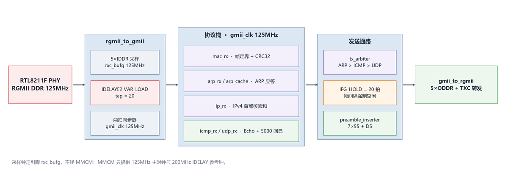
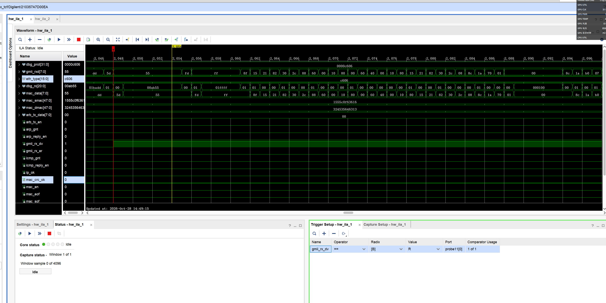
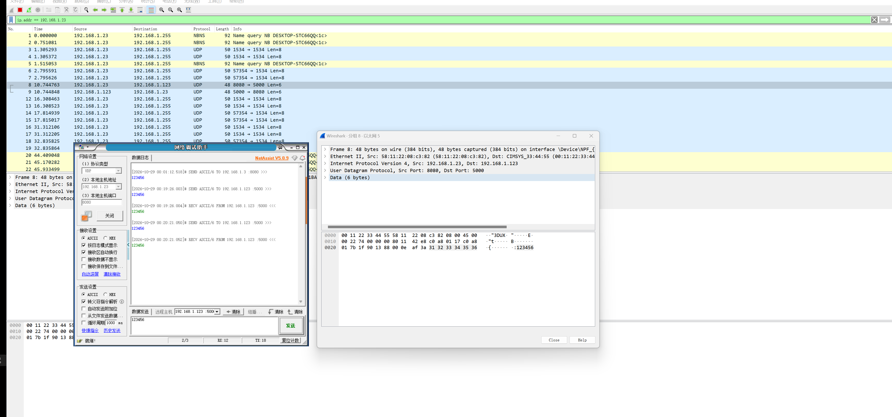

# FPGA 千兆以太网协议栈（RGMII / ARP / IP / ICMP / UDP）

## 项目简介

在 XC7A200T 上独立实现的一条完整千兆以太网通路：板卡能被 PC ping 通，ARP / ICMP Echo 正常应答，收到的 UDP 包原样回显（端口 5000）。纯 RTL 实现，不依赖任何 `.xci` IP 文件。协议栈本身都是状态机，真正麻烦的是 PHY 送来的 RGMII DDR 接口——BUFG 插入延迟、PHY 内部 RGMII-ID 延迟、板级走线 skew 叠在一起，理论采样点未必落在数据眼里，所以把相位做成可调，上板扫一遍后固化，本板命中 tap = 20。

### **系统架构图**

#### [复位架构图](docs/images/reset_tree.png)

#### [时钟架构图](docs/images/clock_tree.png)

## 关键成果

- **协议栈全通**：PC 可 ping 通板卡，ARP / ICMP Echo 正常应答，UDP 5000 端口原样回显，Wireshark 显示 FCS = Good、丢包 0。
- **零 IP 依赖**：不用 `.xci`，MMCME2_BASE / xpm_fifo_sync / xpm_cdc_async_rst 原语直接替代 Clocking Wizard / FIFO Generator。
- **上板验证通过**：综合实现 0 error、0 critical warning，布线后 WNS +0.104ns、WHS +0.036ns，17077 个端点全部满足约束。
- **13/13 testbench PASS**：iverilog 跑完全部自检查用例。
- **相位问题定位并修复**：SFD 由 `FD` 纠正回 `D5`，formal bit 丢包为 0。

## 技术亮点

- **RGMII 源同步采样**：`rgmii_to_gmii` 用引脚时钟 `rxc_bufg` 驱动 5 个 IDDR（`SAME_EDGE_PIPELINED`），Q1/Q2 拼成 GMII 字节，经两拍同步器进主时钟域；`rxd[3:0]` / `rx_ctl` 各串一级 `IDELAYE2(VAR_LOAD)` 做相位可调。
- **IDELAY tap 扫描**：`SCAN_EN=1` 时 FSM 循环扫描，ILA 触发 `mac_crc_ok` 读命中值；`SCAN_EN=0` 时固定为 `IDELAY_TAP`。本板命中 20（约 1.56ns）。
- **MAC 与 FCS 校验**：`mac_rx` 做帧定界、MAC 头提取和 CRC-32 校验，用反射多项式 `0xEDB88320`。
- **三路发送仲裁**：`tx_arbiter` 优先级 ARP > ICMP > UDP，`done` 后强制空闲 `IFG_HOLD=20` 拍；`preamble_inserter` 补 7×`0x55` + `0xD5`。
- **跨时钟域约束**：两路时钟同源但时钟路径偏斜约 4.5ns，用 `set_max_delay -datapath_only 8.000` 只约束数据路径上限，不用 `set_clock_groups -asynchronous` 以免屏蔽 setup 检查。

## 文件说明

- `rtl/`：核心 RTL 代码

### 顶层与 PHY

#### [以太网顶层](rtl/top/eth_top.v)

#### [RGMII 接收转 GMII](rtl/phy/rgmii_to_gmii.v)

#### [GMII 转 RGMII 发送](rtl/phy/gmii_to_rgmii.v)

#### [前导码插入](rtl/phy/preamble_inserter.v)

### MAC 与协议层

#### [MAC 接收与 FCS](rtl/mac/mac_rx.v)

#### [ARP 接收](rtl/arp/arp_rx.v)

#### [ARP 发送](rtl/arp/arp_tx.v)

#### [ARP 缓存](rtl/arp/arp_cache.v)

#### [IP 接收](rtl/ip/ip_rx.v)

#### [ICMP 接收](rtl/icmp/icmp_rx.v)

#### [ICMP 发送](rtl/icmp/icmp_tx.v)

#### [UDP 接收](rtl/udp/udp_rx.v)

#### [UDP 发送](rtl/udp/udp_tx.v)

### 公共模块与仲裁

#### [发送仲裁](rtl/arbiter/tx_arbiter.v)

#### [时钟生成](rtl/common/clk_gen.v)

#### [CRC32](rtl/common/crc32_d8.v)

#### [同步 FIFO](rtl/common/sync_fifo.v)

### 约束与仿真

#### [主引脚约束](constrs/eth_top_full.xdc)

#### [CDC 跨域约束](constrs/diag_cdc.xdc)

#### [仿真说明](sim/README.md)

#### [系统级 TB](sim/tb_eth_top.v)

## 调试记录：SFD 被采成 FD 的相位问题

### 故障现象

`gmii_rx_dv` 有完整整帧波形，但 PC 侧「已发送 N 包、已接收 0 包」，ARP 无应答，`mac_crc_ok` 恒为 0。ILA 上看到前导码 `55..55` 正常，SFD 却是 `FD` 而不是 `D5`，后面的字节跟着整体错半拍。

[调通前的 ping 失败记录](DEBUG/ila_waveform/ping_failed.png)和[ARP 请求无应答抓包](DEBUG/ila_waveform/arp_no_reply.png)也留着——「PC 正常发包、板子完全不应答」这个现象比最后成功那张更能说明问题出在哪一侧。

### 问题分析

IDDR 的采样沿骑在数据翻转沿上，`Q1` 采到上一字节的高 4 位、`Q2` 采到下一字节的低 4 位，拼出来就是 `{L(N+1), H(N)}`，SFD 自然变成 `FD`。

### 排查过程

行为仿真发现不了——仿真模型里主时钟和 `rxc` 同源同相，采样必然正确。只能在板上用 ILA 抓真实波形。

### 解决方案与结果

采样钟改成引脚时钟经一级 BUFG 的 `rxc_bufg`，再在 `rxd[3:0]` / `rx_ctl` 上各串一级 `IDELAYE2(VAR_LOAD)`，把相位做成可调。扫到 tap=20（约 1.56ns）后固化，正式 bit 丢包为 0。换板卡或换 PHY 后把 `SCAN_EN` 改回 1 重新扫一遍即可。

校准完成后 ARP / ICMP / UDP 全通，Wireshark 显示 FCS = Good。

## 已知限制

- 只支持千兆：MMCM 按 125 MHz 输入配置（`M=8, D=1, O=8`，VCO 1000 MHz），换成 25 MHz 时 VCO 只有 200 MHz、低于 600 MHz 下限会失锁，10/100M 自适应没做。
- 依赖 PHY 的 RGMII-ID：PHY 内部延迟是硬件默认配置，没通过 MDIO 写寄存器；换 PHY 或换板卡要重新扫 RX 相位。
- 调试核随正式 bit 一起生成：约束里定义了两个 ILA 和 `dbg_hub`，端点数偏多（17077），DRC 报一条 `RTSTAT-10` 空载网络警告，0 Error。
- 时序收敛不等于功能正确：源同步相位问题行为仿真覆盖不到，以上板结果为准。
