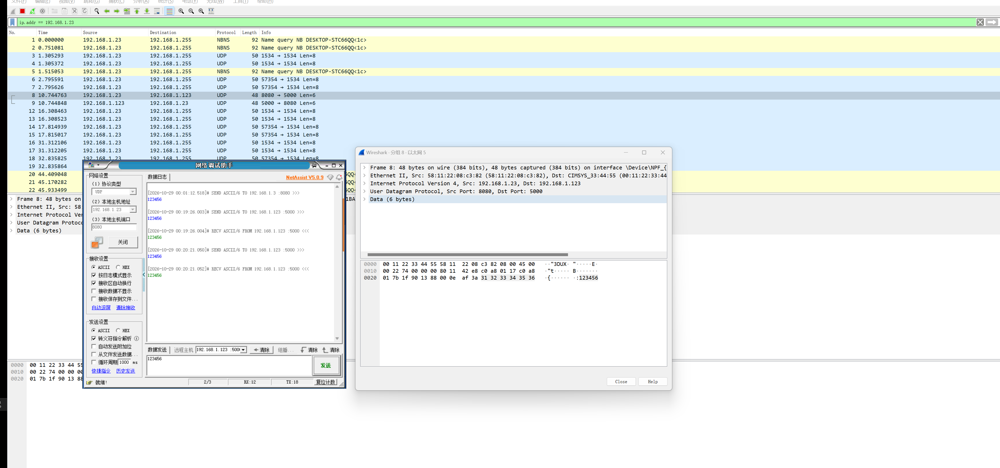
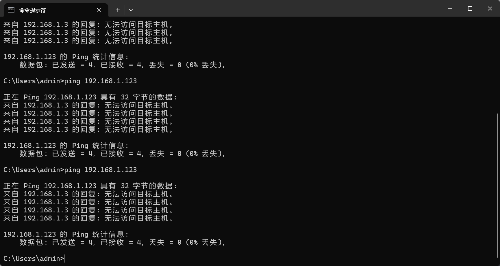
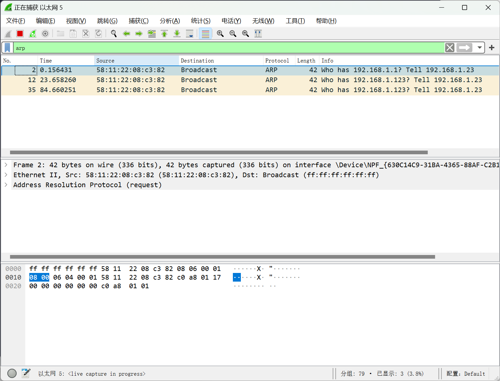
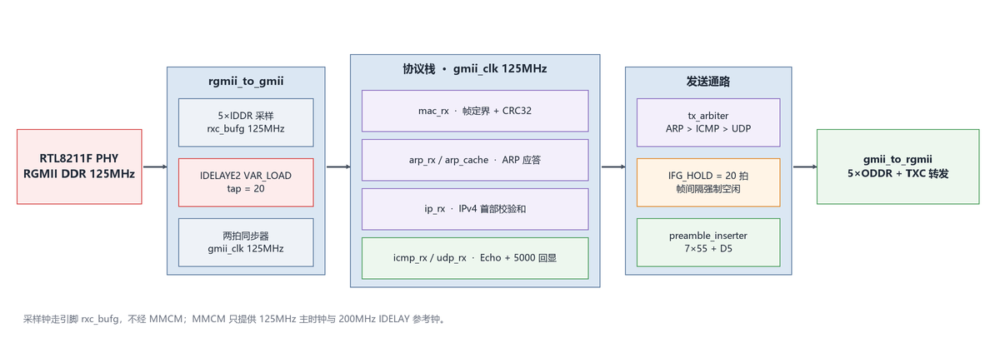
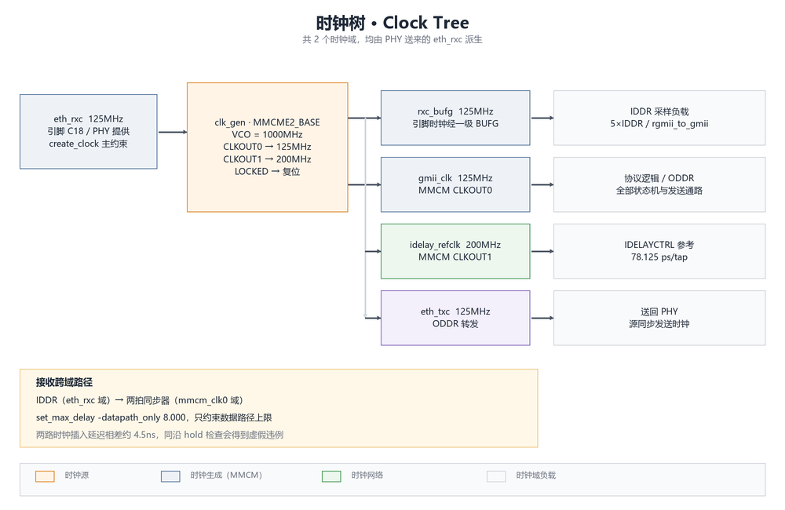
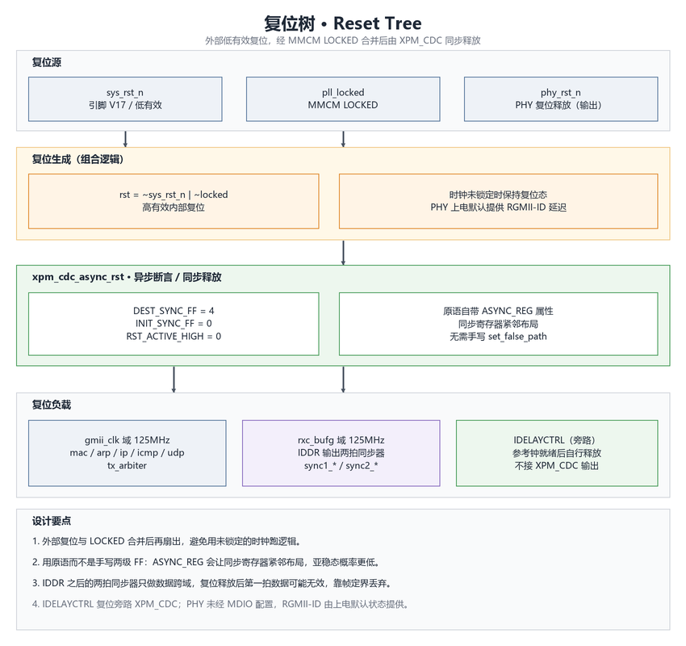
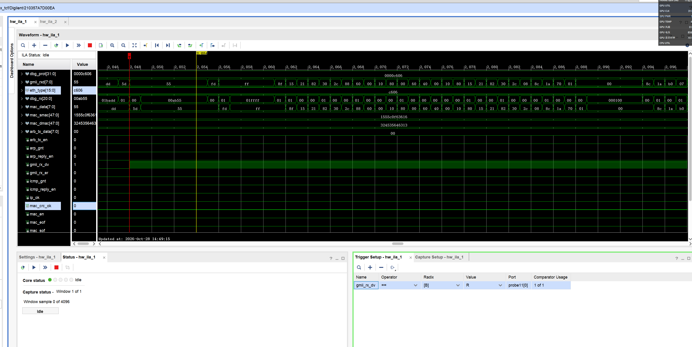

# FPGA 千兆以太网协议栈（RGMII / ARP / IP / ICMP / UDP）

  

在 XC7A200T 上跑通的一条完整千兆以太网通路：板卡能被 PC ping 通，ARP / ICMP Echo 正常应答，收到的 UDP 包原样回显（端口 5000）。纯 RTL 实现，不依赖任何 `.xci` IP 文件。

协议栈本身都是状态机，真正麻烦的是 PHY 送来的 RGMII DDR 接口。`BUFG 插入延迟`、`PHY 内部 RGMII-ID 延迟`、`板级走线 skew` 叠在一起，理论算出来的采样点未必落在数据眼里。所以没有把相位写死，而是用 `IDELAYE2` 做成可调，在板上扫一遍把命中值固化下来，本板扫到的是 tap = 20。

## 实拍



Wireshark 抓到的 UDP 回显：PC 发往 `192.168.1.123:5000` 的数据被原样送回，右侧是帧内容窗口，`"Hello"` 一段可以对照。旁边是网络调试助手，连续收发没有丢包。

 

左边是调通之前的 ping 结果，右边是同期抓包：PC 一直在发 `Who has 192.168.1.123?`，板子一声不吭。这两张留着是因为「PC 正常发包、板子完全不应答」这个现象，比最后成功那张更能说明问题出在哪一侧。

---

## 系统规格

| 项目 | 参数 |
| --- | --- |
| FPGA | Xilinx Artix-7 `xc7a200tfbg484-2L`（野火升腾Pro） |
| 工具版本 | Vivado 2018.3，行为仿真用 iverilog |
| PHY | Realtek `RTL8211F-CG`，RGMII，10/100/1000M |
| 接口 | RGMII DDR，`rxd[3:0]` / `txd[3:0]` + `rx_ctl` / `tx_ctl` |
| 输入时钟 | PHY 提供 `eth_rxc` 125 MHz（周期 8 ns，引脚 C18） |
| 内部时钟 | MMCM 输出 125 MHz 主时钟 + 200 MHz IDELAY 参考钟 |
| 板卡 MAC | `00:11:22:33:44:55` |
| 板卡 IP | `192.168.1.123` |
| UDP 端口 | `5000` |
| IO 电平 | `LVCMOS33`（Bank 14/15/16 均为 3.3 V） |

接收侧靠 PHY 的 RGMII-ID 把 `rxc` 相对 `rxd` 延迟 2 ns，正好落在千兆数据眼中央；FPGA 这一侧只做微调，不重新造相位。发送侧由 FPGA 用 ODDR 把 `TXC` 跟数据一起转发给 PHY。

---

## 系统架构



`docs/images/架构图.vsdx` 是对应的 Visio 源文件，改图时编辑源文件再导出 PNG。

几个关键节点：

- **rgmii_to_gmii** 用引脚时钟 `rxc_bufg` 驱动 5 个 `IDDR`（`SAME_EDGE_PIPELINED`），`Q1/Q2` 拼成 GMII 字节，再经两拍同步器送进主时钟域
- **mac_rx** 做帧定界、MAC 头提取和 FCS 校验，CRC 用反射多项式 `0xEDB88320`
- **ip_rx / icmp_rx / udp_rx** 按 EtherType 与协议号分流，各自只解析自己那一段
- **tx_arbiter** 三路发送互斥，优先级 ARP > ICMP > UDP，`done` 之后强制空闲 `IFG_HOLD=20` 拍
- **preamble_inserter** 补 7×`0x55` + `0xD5`，内部 9 级延迟线需要 8 拍把帧尾冲刷干净
- **gmii_to_rgmii** 用 ODDR 产生 TXC 与 TXD，源同步送回 PHY

---

## 时钟域



整块设计只有两个时钟域，而且同源——都派生自 PHY 送来的 `eth_rxc`。

| 时钟 | 频率 | 来源 | 主要负载 |
| --- | --- | --- | --- |
| `eth_rxc` | 125 MHz | PHY 物理输入 | `create_clock` 主约束 |
| `rxc_bufg` | 125 MHz | `eth_rxc` 经一级 BUFG | 仅 IDDR 采样 |
| `gmii_clk` | 125 MHz | MMCM `CLKOUT0` | 全部协议逻辑 + ODDR 时钟源 |
| `idelay_refclk` | 200 MHz | MMCM `CLKOUT1` | `IDELAYCTRL` 参考 |
| `eth_txc` | 125 MHz | ODDR 从 `gmii_clk` 转发 | 送回 PHY |

采样时钟走引脚、不过 MMCM。数据眼是由 PHY 的 `rxc` 定义的，MMCM 内反馈只补偿了输入侧 BUFG，输出到 IDDR 还多一级 BUFG 加布线延迟（约 1~2 ns），拿它采样容易把采样点推出 ±2 ns 的窗口。

IDDR 输出紧接着是两拍同步器，跨到 `gmii_clk` 域。这两路时钟虽然同源，但分别经过 BUFG 与 MMCM+BUFG，时钟路径偏斜约 4.5 ns；Vivado 会按「相关时钟同沿」对同步器做 0 ns 的 hold 检查，得到一个并不存在的违例。约束上单独处理这一条：

```tcl
set_max_delay -datapath_only 8.000 \
    -from [get_clocks eth_rxc] -to [get_clocks mmcm_clk0]
```

只约束数据路径上限，setup 侧仍然受控，但不再让时钟偏斜参与 hold 检查。没有用 `set_clock_groups -asynchronous`，那会把这条路径的 setup 检查一起屏蔽掉。推导与实测数据见 `constrs/diag_cdc.xdc`。

---

## 复位设计



外部 `sys_rst_n` 低有效，进来后与 MMCM 的 `LOCKED` 合并：时钟没锁定就一直按在复位态，避免用不稳定时钟跑逻辑。跨到各时钟域用 `xpm_cdc_async_rst` 做异步断言、同步释放，原语自带 `ASYNC_REG`，不用再手写 `set_false_path`。

`phy_rst_n` 由 FPGA 拉高释放 PHY 复位，RGMII-ID 内部延迟是 PHY 上电默认配置，工程没有通过 MDIO 写寄存器。

---

## 调试记录

留着这些截图是因为踩过的坑比代码本身有价值。



> **现象**：`gmii_rx_dv` 有完整整帧波形，但 PC 侧「已发送 N 包、已接收 0 包」，ARP 无应答，`mac_crc_ok` 恒为 0。ILA 上看到前导码 `55..55` 正常，SFD 却是 `FD` 而不是 `D5`，后面的字节跟着整体错半拍。
>
> **定位**：IDDR 的采样沿骑在数据翻转沿上，`Q1` 采到上一字节的高 4 位、`Q2` 采到下一字节的低 4 位，拼出来就是 `{L(N+1), H(N)}`。行为仿真发现不了——仿真模型里主时钟和 `rxc` 同源同相，采样必然正确。
>
> **处理**：采样钟改成引脚时钟经一级 BUFG 的 `rxc_bufg`，再在 `rxd[3:0]` / `rx_ctl` 上各串一级 `IDELAYE2(VAR_LOAD)`，把相位做成可调。

`SCAN_EN=1` 时内部 FSM 循环扫描 tap，用 ILA 触发 `mac_crc_ok` 并读 `dbg_prot & 0x1F` 拿到命中值；`SCAN_EN=0` 时 tap 固定为 `IDELAY_TAP`。本板命中 20（约 1.56 ns），固化后正式 bit 丢包为 0。换板卡或换 PHY 后把 `SCAN_EN` 改回 1 重新扫一遍即可。


> 校准完成后 ARP / ICMP / UDP 全通，Wireshark 显示 FCS = Good。综合实现 0 error、0 critical warning，布线后 WNS +0.104 ns、WHS +0.036 ns，17077 个端点全部满足约束。

---

## 目录结构

```
.
├── README.md
├── LICENSE                         MIT
├── create_project.tcl              一键重建 Vivado 工程
├── .gitignore / .gitattributes
│
├── rtl/
│   ├── top/eth_top.v               顶层连线
│   ├── phy/                        RGMII ↔ GMII，IDELAYE2 相位校准
│   ├── common/                     MMCM 时钟、CRC32、同步 FIFO
│   ├── mac/ mac_rx.v              帧定界 + MAC 头 + FCS
│   ├── arp/                       ARP 应答与缓存
│   ├── ip/ icmp/ udp/             协议解析与应答
│   └── arbiter/                   三路发送仲裁 + IFG 强制空闲
│
├── constrs/                       主引脚约束 + CDC 跨域约束
├── ip/                            空目录（本工程零 IP 文件依赖）
├── sim/                           13 个自检查 testbench，见 sim/README.md
├── docs/images/                   架构图 / 时钟树 / 复位树（PNG + VSDX 源文件）
├── IO/                            开发板引脚映射表 pin_mapping.xlsx
└── DEBUG/                         上板实测截图与 ILA 波形
```

`fpga_ethernet_no90_new.xpr` 不入库。`.xpr` 里写死了生成它的机器上的绝对路径，换台电脑就打不开，统一用下面的脚本重建。

---

## 重建工程

```bash
cd <本仓库目录>
vivado -mode tcl -source create_project.tcl
```

脚本里的路径用 `[file dirname [info script]]` 动态算，放哪个目录都能跑。它会建好工程、加完 17 个 RTL、两份约束、全部仿真源文件，配好顶层 `eth_top`。之后在 Vivado 里跑综合 → 实现 → 生成比特流即可。

`docs/images/` 里除了 PNG，还留了对应的 `.vsdx` Visio 源文件，改图时编辑源文件再导出即可。

本工程没有 `.xci`，`ip/` 目录暂时是空的，用 `MMCME2_BASE`、`xpm_fifo_sync`、`xpm_cdc_async_rst` 这些原语直接替代了 Clocking Wizard / FIFO Generator，重建时不需要生成 IP 输出产品。

行为仿真用 iverilog 跑 `sim/` 下的 13 个自检查用例，或重建工程后直接用 Vivado xsim，方法见 [sim/README.md](sim/README.md)。本地另有一键脚本，汇总输出 `PASS = 13, FAIL/异常 = 0`，不随本仓库发布。

---

## 已知限制

### 只支持千兆

MMCM 按 125 MHz 输入配置（`M=8, D=1, O=8`，VCO 1000 MHz）。输入换成 25 MHz 时 VCO 只有 200 MHz，低于 600 MHz 下限会失锁，所以 10/100M 自适应没做。

### 依赖 PHY 的 RGMII-ID

PHY 内部延迟由硬件默认配置提供，工程没有通过 MDIO 写寄存器。换 PHY 或换板卡后，板级走线 skew 变了，需要把 `SCAN_EN` 改回 1 重新扫 RX 相位。

### 调试核随正式 bit 一起生成

`constrs/eth_top_full.xdc` 里定义了两个 ILA 和 `dbg_hub`，端点数因此偏多（17077）。拆到独立约束文件只在调试时加载能拿到更大余量，但不是必需。DRC 会报一条 `RTSTAT-10` 空载网络警告，来自 `dbg_hub` 内部，0 Error。

### 其他

- 工具脚本里的路径是按本机位置写的，克隆后需要改成实际路径；`create_project.tcl` 不受影响
- `DEBUG/` 下目前只有静态截图，实时演示录像后续补齐；引脚以 `constrs/eth_top_full.xdc` 与 `IO/pin_mapping.xlsx` 为准
- 时序收敛不等于功能正确：源同步相位问题行为仿真覆盖不到，以上板结果为准

---

## License

MIT，见 [LICENSE](LICENSE)。
