# OV5640 + DDR3 + HDMI 图像采集显示系统

  

在 XC7A200T 上跑通的一条完整视频通路：OV5640 采集 720P 图像，写进 DDR3 做帧缓存，再按 720P@60 的时序读出来送 HDMI 显示。

写这个的动机很直接——把采集、缓存、显示三段串起来之后，跨时钟域和复位这两块必须自己想清楚。这两件事分开看代码都很简单，问题是串起来之后，一个没清干净的 FIFO 就能让你对着屏幕上一堆拼接错位的色块查一整天。板级调试的完整过程记在下面的「调试记录」。

## 实拍

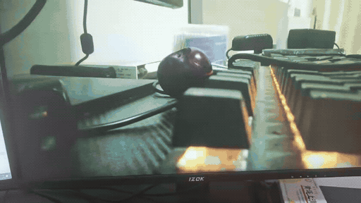

最终效果：摄像头对准桌面实时采集，经 DDR3 帧缓存后送到 HDMI 显示器。画面里的鼠标和 RGB 键盘是摄像头实际拍到的东西，手持时整个画面会跟着晃。

这段是从录像里截的 6 秒。转 GIF 前做了轻度降噪——原素材噪点偏多，压成 GIF 之后噪点会放大成满屏跳动的噪块，反而看不清内容。完整 13 秒的录像在 [demo_live.mp4](DEBUG/demo_live.mp4)。

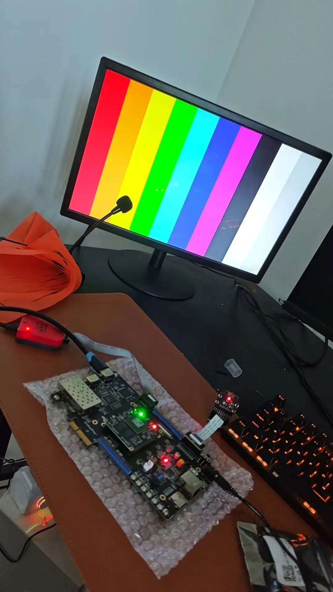

`COLOR_TEST=1` 时的彩条模式：跳过摄像头和 DDR，直接由 FPGA 按 `pix_x` 生成八色竖条。这是板级调试时加进来的定位手段，一次烧板就能把问题二分：

| 彩条现象 | 结论 |
| --- | --- |
| 八色全对 | 显示通路（SiI9134 配置 + RGB888 时序）正常，偏色来自摄像头数据 |
| 彩条错色 | 显示端问题，查 HDMI 编码芯片的输入格式与寄存器配置 |
| 彩条错位 | 分屏根因在显示端 |

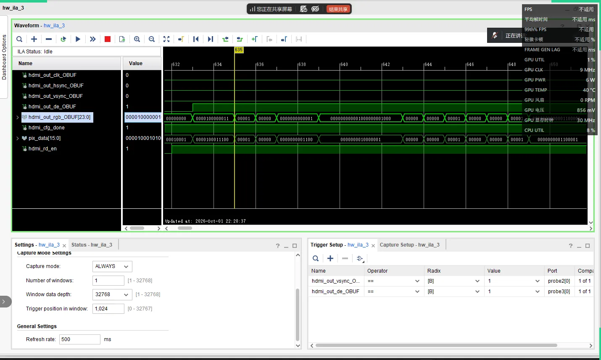

HDMI 输出侧的 ILA 抓包，从上到下是 `hdmi_out_clk`、`hsync`、`vsync`、`de`、`rgb[23:0]`。

---

## 系统规格

| 项目 | 参数 |
| --- | --- |
| FPGA | Xilinx Artix-7 xc7a200tfbg484-2 |
| 工具版本 | Vivado 2018.3 |
| 摄像头 | OV5640，1280×720，RGB565，30 fps |
| 输入接口 | DVP 8bit（pclk / vsync / href / data[7:0]） |
| 配置接口 | SCCB（兼容 I2C），上电写 251 个寄存器 |
| 帧缓存 | DDR3，MIG 7-series，32bit 数据总线 |
| 显示输出 | HDMI 1280×720 @ 60 fps |
| 显示芯片 | SiI9134，经 DDC（I2C）配置 |
| 系统时钟 | 50 MHz 板载晶振（引脚 W19） |

摄像头 30fps 写入、HDMI 60fps 读出，速率不等也能跑，靠的是中间的 DDR3 做解耦。代价是同一帧会被显示两次，而且画面一动就会出现撕裂，原因见文末。

---

## 系统架构

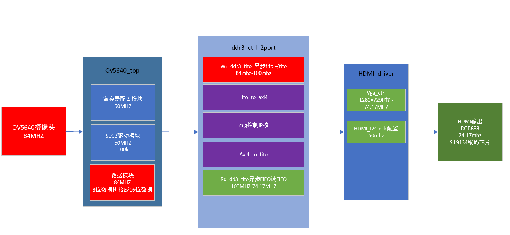

数据流向：上面一行采集（左→右）写进 DDR3，下面一行显示（右→左）读出来送 HDMI。

几个关键节点：

- **ov5640_data** 把 DVP 的 8bit 数据两两拼成 16bit 的 RGB565，同时给出写使能
- **wr_ddr3_fifo** 做第一次跨时钟域，写侧 84MHz、读侧 100MHz，顺带完成 16bit→128bit 的位宽转换
- **fifo_to_axi4** 把拼好的数据打包成 AXI4 写突发，`AWLEN = 31`，一次 32 拍共 512 字节
- **axi4_to_fifo** 反向，发起读突发后回填到读 FIFO
- **rd_ddr3_fifo** 第二次跨时钟域，从 100MHz 回到 74.17MHz 的显示时钟
- **vga_ctrl** 生成 1280×720@60 的行场时序，顺便给出读请求

配置通路独立跑在 50MHz：摄像头走 SCCB（16bit 寄存器地址），SiI9134 走 DDC（8bit 寄存器地址）。这两条共用同一套 I2C 驱动逻辑，各自例化一份——两种器件的寄存器地址宽度不同，地址模式没切对会导致编码芯片初始化失败，这个坑记在「调试记录」第 3 条。

---

## 时钟域

整块设计一共 5 个时钟域，其中 `cam1_pclk` 来自摄像头、不是本时钟系统产生的，属于真正的异步源。

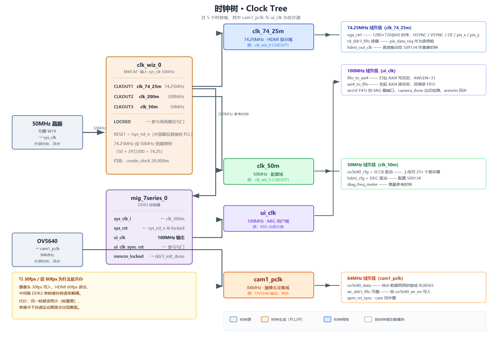

| 时钟 | 频率 | 来源 | 主要负载 |
| --- | --- | --- | --- |
| `sys_clk` | 50 MHz | 板载晶振 W19 | clk_wiz_0 输入 |
| `clk_74_25m` | 74.172 MHz（标称 74.25） | PLL CLKOUT0 | vga_ctrl、rd_ddr3_fifo 读侧、hdmi_out_clk |
| `clk_200m` | 200 MHz | PLL CLKOUT1 | MIG 参考时钟 |
| `clk_50m` | 50 MHz | PLL CLKOUT2 | SCCB / DDC 配置、频率计 |
| `cam1_pclk` | 84 MHz | 摄像头输出 | ov5640_data、wr_ddr3_fifo 写侧 |
| `ui_clk` | 100 MHz | MIG 输出 | AXI4 读写两端 |

**一个容易踩的坑**：`clk_74_25m` 这个名字是标称 74.25 MHz，早期 clk_wiz 用整数分频 `CLKOUT2_DIVIDE = 19`，VCO 1400 MHz / 19 实际只给出 **73.684 MHz**，误差 −0.76%，超出 720P 要求的 ±0.5%，部分显示器会不锁、闪屏或偏色。7 系列只有 CLKOUT0 / CLKOUT1 支持 .125 小数分频，所以把显示时钟挪到 CLKOUT0 并设 `CLKOUT0_DIVIDE_F = 18.875`，得到 74.172 MHz（误差 −0.10%，落在容差内）。另外 `hdmi_out_clk` 是 MMCM 直接驱动 OBUF 出来的，要进一步改善抖动可以用 ODDR 转发。

约束上把 `cam1_pclk` 单独异步出去：

```tcl
create_clock -period 11.905 -name cam1_pclk [get_ports cam1_pclk]
set_clock_groups -asynchronous \
    -group [get_clocks -include_generated_clocks sys_clk] \
    -group [get_clocks -include_generated_clocks cam1_pclk]
```

`cam1_pclk` 没走专用时钟引脚，走的是普通 IO，所以约束里带了 `set_property CLOCK_DEDICATED_ROUTE FALSE`。这不是偷懒——这块板子的摄像头接口就是这么连的，代价是时钟抖动比专用引脚差一些。

---

## 复位设计

这是整个项目里最绕的部分，单独画了一张图。

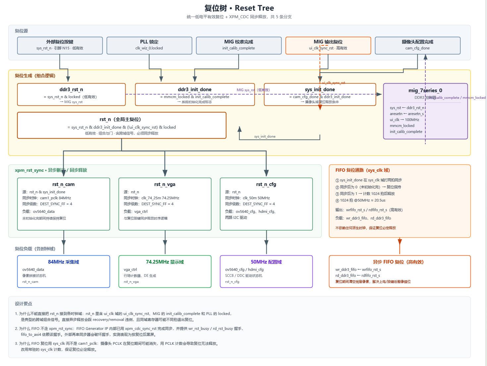

### 问题

最开始的写法是把复位做成一个组合与门，直接扇出到三个时钟域：

```verilog
assign rst_n = sys_rst_n & ddr3_init_done & (!ui_clk_sync_rst) & locked;
```

`ddr3_init_done`、`ui_clk_sync_rst` 来自 `ui_clk`(100MHz) 域，`sys_rst_n`、`locked` 来自 `sys_clk`(50MHz) 域，纯组合相与后同时送给 50MHz 的采集/配置和 74MHz 的显示当异步复位。各路信号到达时刻不同会生成窄毛刺，可能造成状态机被意外清零或半复位；释放沿也可能落在目标时钟的建立/保持窗口里导致 recovery/removal 违例。

### 解法

用 Xilinx 的 `xpm_cdc_async_rst` 原语（异步断言、同步释放）给每个时钟域各生成一份：

```verilog
xpm_cdc_async_rst #(
    .DEST_SYNC_FF   (4),
    .INIT_SYNC_FF   (0),
    .RST_ACTIVE_HIGH(0)     // 本项目 rst_n 为低有效
) u_rst_sync_cam (
    .src_arst (cam_rst_src),
    .dest_clk (cam_clk),
    .dest_arst(rst_n_cam)
);
```

选原语而不是手写两级 FF，是因为它自带 `ASYNC_REG` 属性，布局时会把同步寄存器放紧邻，亚稳态概率比手写低；时序约束也由原语自带，不用再手写 `set_false_path`。

采集域（`rst_n_cam`）额外串了一个条件：`src_arst = rst_n & sys_init_done`。意思是摄像头没配置完之前，采集端一直按着复位不放——配置过程中摄像头输出的数据是乱的，与其接收了再丢，不如从源头卡住。

### FIFO 单独走一路

读写两个异步 FIFO **没有**接上面这三条复位，而是由顶层用**常驻的 `sys_clk`** 单独产生 `fifo_rst_sys`：`sys_init_done` 同步两拍后，在系统未初始化完成期间一直保持复位，初始化完成后再保持 **1024 拍**（20.5 μs @50MHz）确保 FIFO 清干净，然后释放。

这 1024 拍不是等 DDR3 控制器稳定，是**把 FIFO 里残留的像素彻底清掉**。释放时刻远早于摄像头 I2C 配置完成（几十 ms），不会丢有效像素。

用 `sys_clk` 而不用 `cam1_pclk` / `clk_74_25m` 计数，是板级验证出来的：v1 用各自时钟域计数产生复位，复位期间摄像头 PCLK 一旦消失，计数器就不推进 → 写 FIFO 永久复位 → `wr_rst_busy` 常高 → 不写 DDR → `camera_w_done` 不来 → 读侧 `rd_enable` 永不启动 → 黑屏。常驻时钟保证复位一定会释放。

这段清零逻辑补的就是「每按一次复位键就出现一次图像拼接错乱」的洞，详见「调试记录」第 5 条。

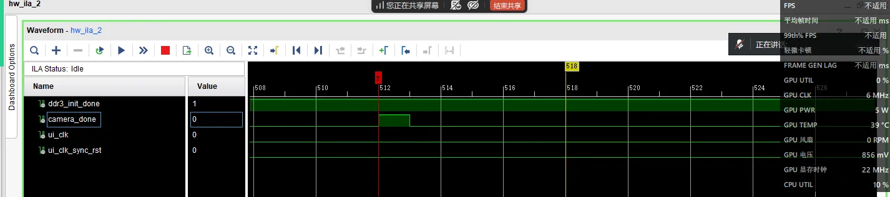

上面两条是 `ddr3_init_done` 和 `camera_done`，下面两条是 `ui_clk` 和 `ui_clk_sync_rst`。可以看到初始化完成后 `camera_done` 开始周期性拉脉冲，每帧一次。

---

## 调试记录

留着这些截图是因为踩过的坑比代码本身有价值。板级调试一共走过六条主线，按当时的排查顺序记在下面。

### 1. MIG 复位极性接反

MIG 在 `mig_a.prj` 里配的是 `SysResetPolarity = ACTIVE LOW`，顶层却按高有效驱动，写成 `ddr3_rst = (~sys_rst_n) | (~locked)`，MIG 被永久按在复位里，`ddr3_init_done` 始终为 0。改成 `ddr3_rst = sys_rst_n & locked` 后，仿真初始化成功、有信号了，单个 DDR 模块的输出数据和发送数据比对一致，ILA 抓 `locked` 和初始化信号都正常。但此时上板屏幕还是黑屏——当时还没有时序约束文件。

### 2. 像素时钟实际是 73.684 MHz，不是 74.25 MHz

黑屏期间查到的第二个问题：clk_wiz 用 `VCO = 50 × 28 = 1400 MHz`、`CLKOUT2_DIVIDE = 19`，显示时钟实际是 73.684 MHz，误差 −0.76%，而 720P 要求 74.25 MHz ± 0.5%，部分显示器会不锁、闪屏或偏色。手动把显示时钟挪到支持小数分频的 CLKOUT0、设 `CLKOUT0_DIVIDE_F = 18.875` 得到 74.172 MHz（误差 −0.10%）后校正回来，可是屏幕依旧黑屏，单模块仿真依旧通过。时钟精度的完整结论见「时钟域」一节。

### 3. 彩条测试定位黑屏：I2C 地址模式没切换

单个 HDMI 模块此前跑过仿真、也上板做过彩条测试，所以先排除 HDMI 时序问题。彩条正常显示，说明 `hdmi_cfg` 配置、`vga_ctrl` 时序、显示时钟、TMDS 编码、引脚约束这一整条 HDMI 发送通路全部没问题，直接排除了大部分硬件与底层配置隐患，问题被锁定在 `OV5640 采集 → DDR3 读写 → 读 FIFO → HDMI 显示` 这条数据链路上。同时重新验证了 640×480 和 1280×720 的彩条、更换了不同的显示屏，确认帧信号是正极性，排除极性导致的黑屏。

但整系统调试时，屏蔽掉摄像头和 DDR3 之后**依旧黑屏、连彩条都不出**——问题回到显示端。检查 HDMI 寄存器配置文件，配置值按官方例程配的、没有写错，最终发现是 `ADDMODE` 写成了 1：野火这块板子的 SiI9134 寄存器地址是 **8 位**，而 OV5640 是 16 位，地址模式没跟着切换。仿真只能验证送进芯片的数据正常，SDA 上的 32 位数据也没错，所以仿真照样通过，但编码芯片初始化其实没成功。改成 8 位地址后彩条正常，去掉彩条逻辑，图像出现正常画面。

### 4. 画面偏绿、颜色错误：HDMI 编码芯片寄存器配置

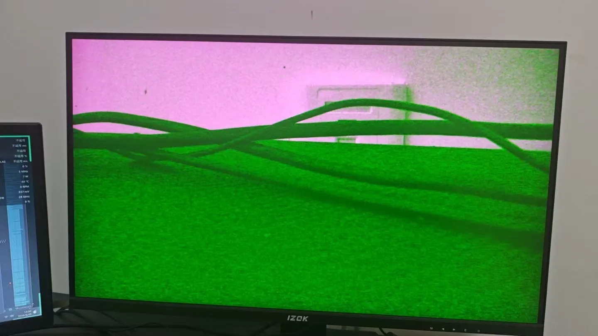

> **整体偏绿、画面分屏。** 原因是 **HDMI 编码芯片（SiI9134）侧的寄存器配置**：中途误判为「寄存器配少了 / RGB 补位补错位数」，于是往编码芯片多写了一组寄存器配置，反而破坏了 RGB 直通、出现颜色错误；退回原先的那套配置后颜色恢复正常。所以既不是 OV5640 寄存器配置没生效，也不是 RGB565 → RGB888 的补零位数搞错（顶层 `{rgb[15:11],3'b0} / {rgb[10:5],2'b0} / {rgb[4:0],3'b0}` 一直是标准的高位对齐低位补零）。这类问题用 `COLOR_TEST=1` 的彩条模式一测就能二分到显示端。

### 5. 每按一次复位键就出现一次图像拼接错乱

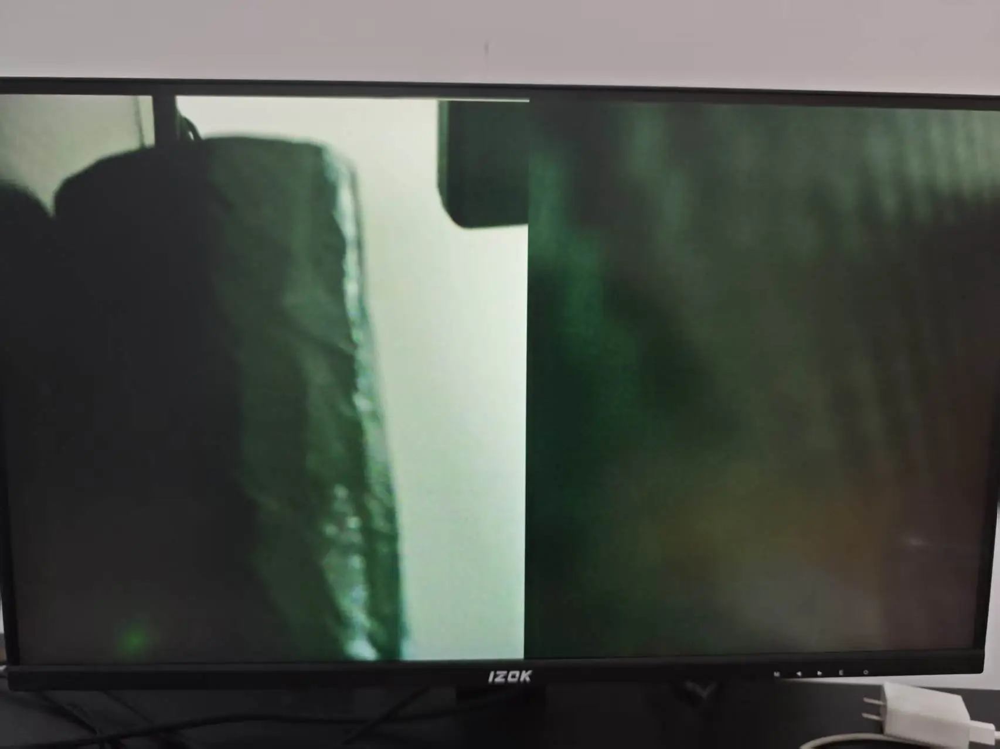

> **上电时图像正常，每按一次复位键就发生一次图像拼接错位，而且每次错乱的位置都不一样。注意这不是单缓冲撕裂**，两者的现象和成因完全不同（撕裂见文末「单缓冲引起的撕裂」）。
>
> 根因是两个异步 FIFO 的复位被硬接 `1'b0`，**从不复位**：上电时 FIFO 是确定的干净初值，所以能正常出图；按复位键时摄像头本身并没有复位（一直输出像素），FPGA 复位释放后接着往装着**上一帧残余像素**的 FIFO 里写，读出的数据流变成「旧帧尾巴 + 新帧」，帧起点整体偏移，画面就被打散成左右拼接的两半。每次复位残留的像素数不同，错乱位置自然每次都不一样。
>
> 仿真阶段也暴露了同一处：FIFO 从不复位 → `FIFO_BUSY` 一直为高 → DDR 不允许写数据 → 摄像头数据一开始就没写进 DDR3 → 读侧没有读请求、`rd_enable` 永不启动。上电能正常出图只是因为**硬件上电会自动做一次复位**。
>
> 解决方法是增加 FIFO 清零复位逻辑：与系统复位同步，用常驻 `sys_clk` 把两个 FIFO 一起复位并保持足够长时间，上板验证复位后问题解决。完整实现见「复位设计」的 FIFO 小节。

### 6. 单缓冲撕裂

单缓冲下读 60fps 快于写 30fps，撕裂无法避免，属于这一版的固有限制，详见文末「单缓冲引起的撕裂」。解决办法是开双缓冲做乒乓，本系列的 `double_buffer/` 就是对应的版本。

### 调试期间同步做的加固

- **顶层加 `COLOR_TEST` 八色彩条**：旁路摄像头和 DDR，一次烧板就能排除 HDMI 侧错误，是上面第 3、4 条的定位基础
- **加频率计 `rtl/freq_meter/`**：实测 `cam1_pclk` 84 MHz、摄像头 30 FPS、HDMI 60 fps，以及 VSYNC 高电平宽度和帧周期，既验证 720P 链路稳定，也为异步时钟约束 XDC 提供依据。模块纯「只读」，不接进数据通路，输出端口都加了 `mark_debug`，综合后在 Vivado 里 Tools → Set Up Debug 直接挂 ILA 看
- **补齐时间单位声明**：`axi4_to_fifo.v` 原先缺 `` `timescale 1ns / 1ps ``，仿真时间单位不受控
- **约束补 `create_clock`**：原先没有主时钟约束，顶层时序无法收敛
- **跨时钟域复位改用 XPM-CDC 同步释放**：消除组合与门异步复位带来的毛刺，见「复位设计」

有个坑值得记一下：加完频率计之后 WNS 掉到 −2.511ns。原因是显示时钟和 50MHz 是同一个 MMCM 的输出，Vivado 会对它们之间的路径做真实时序分析，而那条路其实只是两级同步器。补一个 `constrs/diag_cdc.xdc` 设伪路径就回去了。

---

## 目录结构

```
.
├── README.md
├── LICENSE                    MIT
├── create_project.tcl         一键重建 Vivado 工程
├── .gitignore / .gitattributes
│
├── rtl/
│   ├── top/ov5640_ddr_hdmi.v  顶层连线
│   ├── camera/                OV5640 采集：SCCB 配置 + 8→16bit 拼接
│   ├── ddr3/                  FIFO ↔ AXI4 适配 + MIG 封装
│   ├── hdmi/                  DDC 配置 + VGA 时序
│   ├── freq_meter/            板级频率与帧率测量（调试用）
│   └── xpm_cdc/               跨时钟域复位同步
│
├── constrs/                   引脚约束 + CDC 伪路径
├── ip/                        Vivado IP（只入库 .xci / .prj）
├── sim/                       仿真顶层，详见 sim/README.md
├── docs/                      设计文档与图
├── IO/                        开发板引脚映射表
└── DEBUG/                     调试过程截图
```

`ov5640_ddr3_hdmi_new.xpr` 不入库。`.xpr` 里写死了生成它的机器上的绝对路径，换台电脑就打不开——这正是 `READ_ME.txt` 里提到「路径已损坏」的原因。

---

## 已知限制

### 单缓冲引起的撕裂

这是单缓冲最直观的代价。两张实拍：

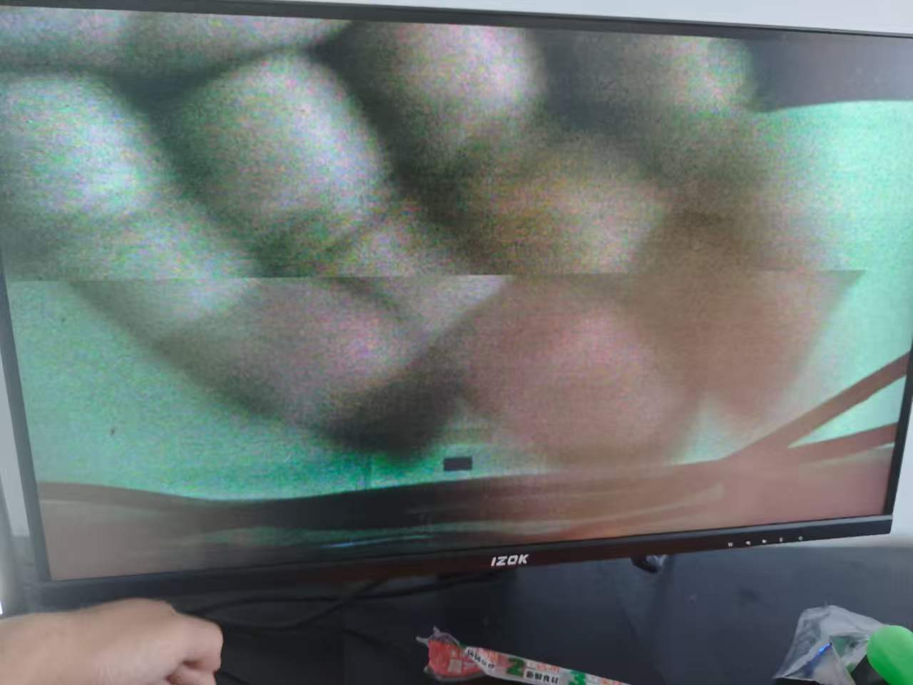 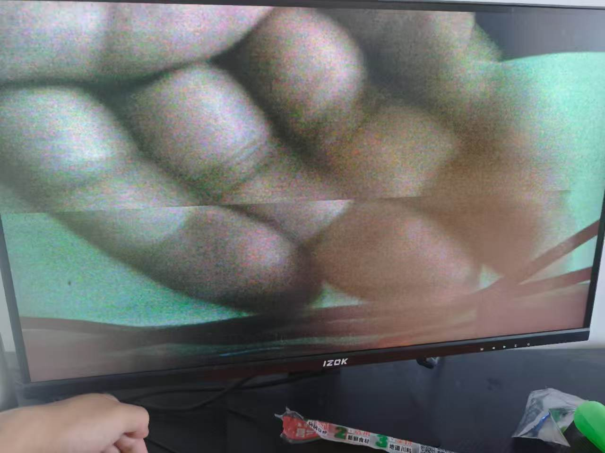

两张图里那条横贯画面的水平接缝，位置明显不一样——左边那张在画面上部约三分之一处，右边那张在中部偏下。**接缝位置不固定这件事本身就是判断依据。**

成因是 DDR3 里只开了一帧的缓冲，写端和读端操作同一块地址：`camera_done` 拉高表示写满一帧，之后写端立刻从头开始覆盖下一帧；显示端则完全按自己的 60fps 节奏往外读，两边之间没有握手。

所以当写端开始写新一帧、而读端正读到画面中间某一行时，读端上半屏拿到的是上一帧的尾部、下半屏拿到的是新帧的开头，接缝就出现在那个交汇点上。又因为 60fps 和 30fps 之间没有严格锁相，读写指针每次相遇的行号都不一样，接缝位置也就一直在漂。

静止画面看不出来——相邻两帧内容几乎相同，切了也分辨不出。镜头一动，接缝立刻可见。

要彻底解决得开双缓冲做乒乓：写 A 读 B，写满一帧后翻转地址，读写永远落在不同区域。代价是多占一帧 DDR3 空间，而且翻转时机必须对齐 VSYNC，落在帧中间切的话还是会撕。三缓冲能容忍更大的读写速率差，代价是延迟增加一帧。

> 顺带说明一下上面两张图的画质：手机的摄像头对着屏幕翻拍，摩尔纹和噪点都很重，加上当时 OV5640 还没完全配好颜色，画面偏色。这些都是拍摄和传感器的问题，接缝本身则是单缓冲造成的。

### 其他

- `cam1_pclk` 走普通 IO 而非专用时钟引脚，抖动指标比专用时钟差
- RGB565 转 RGB888 用的是低位补零，没有做色阶补偿，暗部会有轻微色带
- 写 FIFO 的 `full` / 水位信号在顶层悬空，30fps 下不会写满，若提高输入帧率需要接入背压
