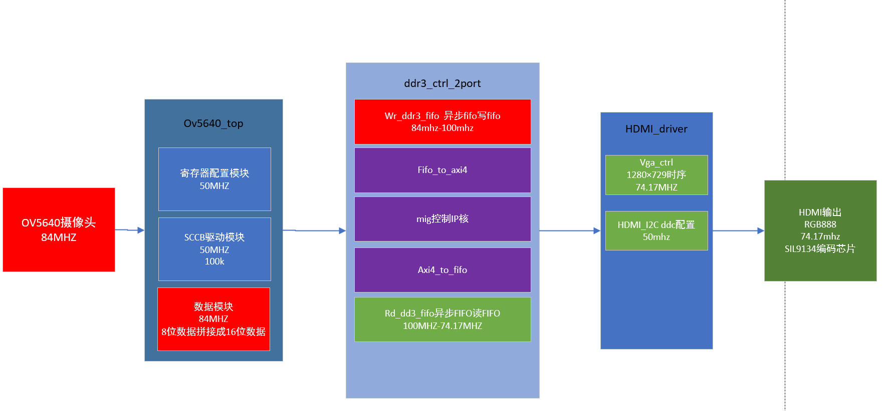
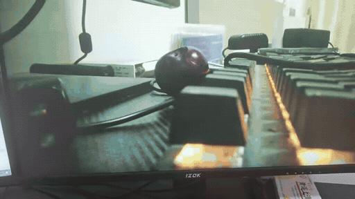
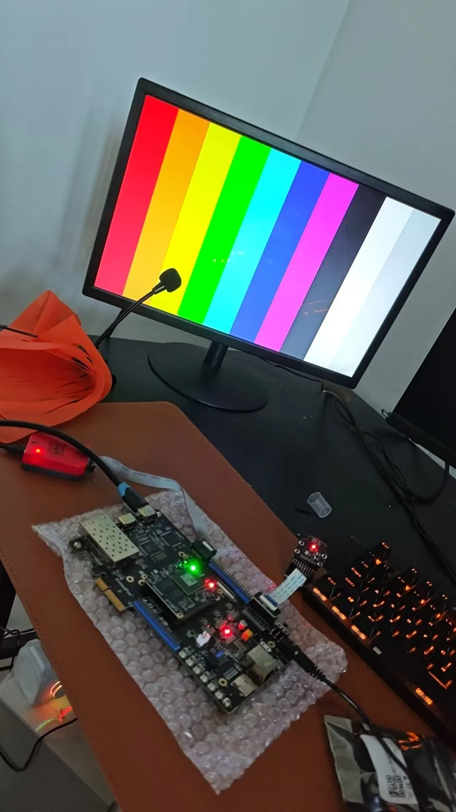
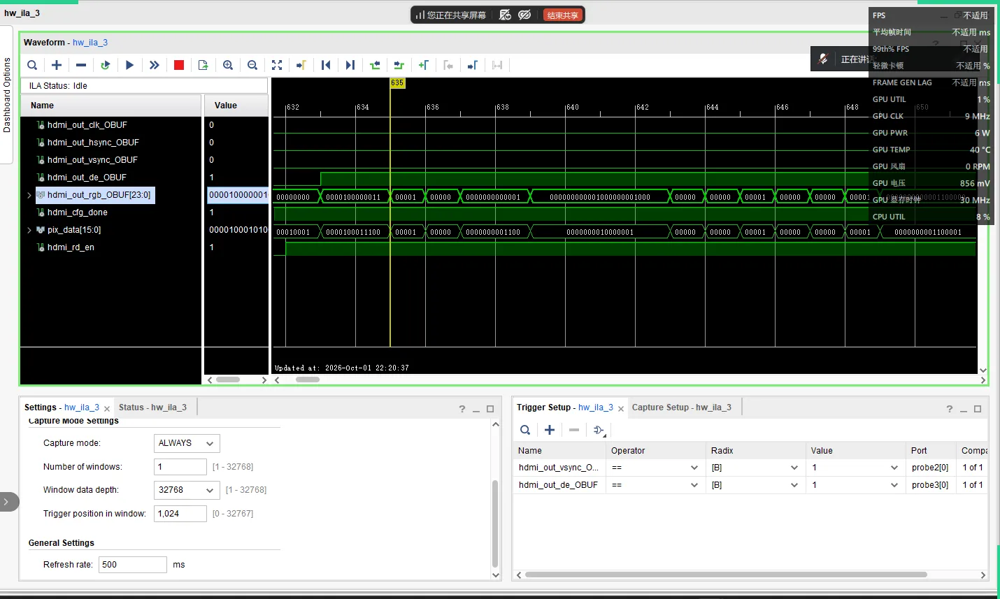
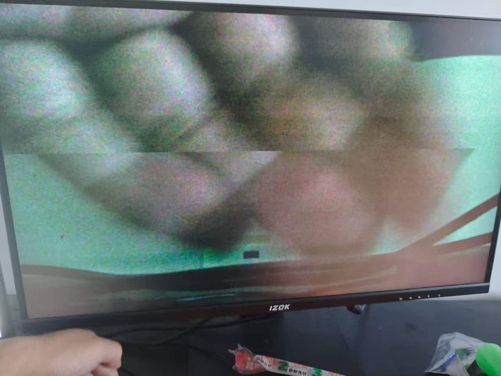
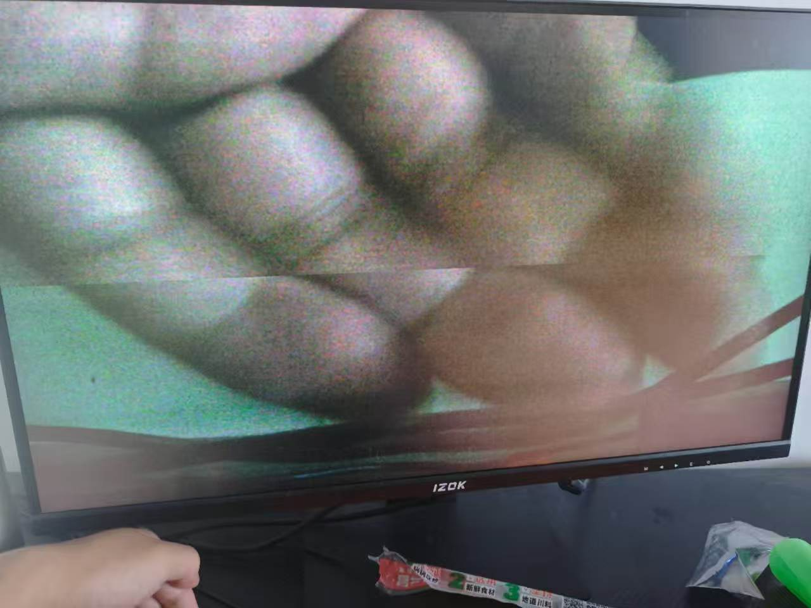
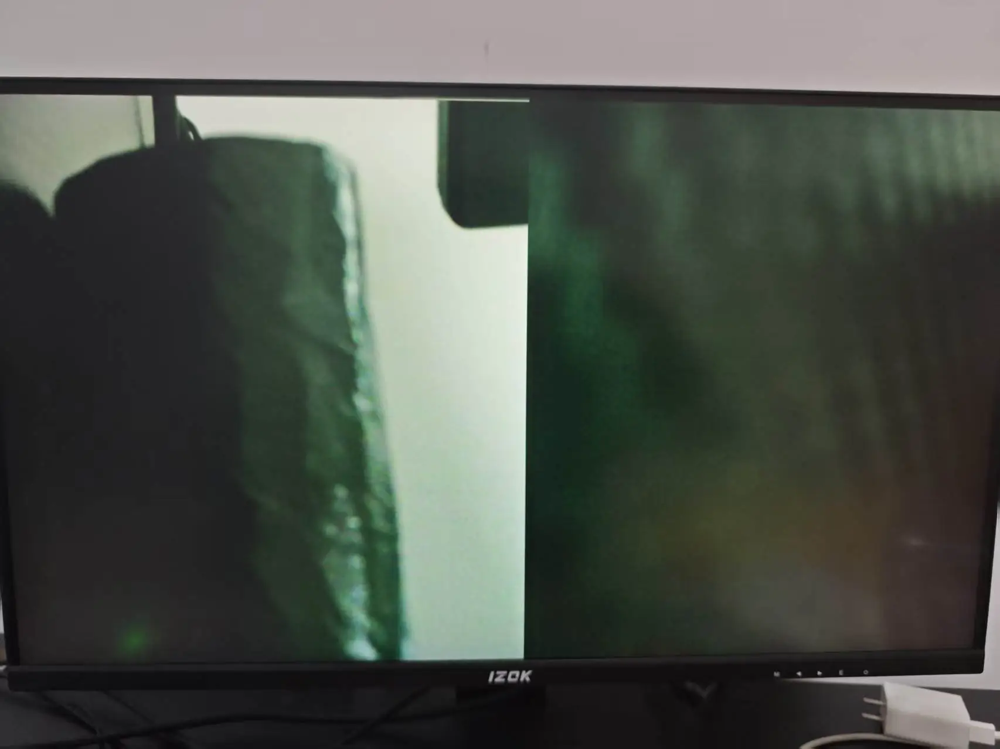
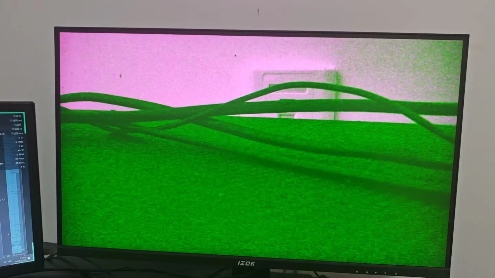

# OV5640 + DDR3 + HDMI 图像采集显示系统

## 项目简介
在 XC7A200T 上跑通的一条完整视频通路：OV5640 采集 720P 图像，写进 DDR3 做帧缓存，再按 720P@60 的时序读出来送 HDMI 显示。写这个的动机很直接——把采集、缓存、显示三段串起来之后，跨时钟域和复位这两块必须自己想清楚；一个没清干净的 FIFO 就能让你对着屏幕上一堆拼接错位的色块查一整天。

### **视频缓存架构图**

#### [复位架构图](docs/images/reset_tree.png)
#### [时钟架构图](docs/images/clock_tree.png)

## 关键成果
- **全链路跑通**：摄像头 30fps 写入、HDMI 60fps 读出，画面实时显示。
- **板级问题逐个定位**：MIG 复位极性、像素时钟精度、I2C 地址模式、偏绿、复位拼接错乱、单缓冲撕裂，六条主线全部查清。
- **时序收敛**：补齐主时钟约束和 CDC 伪路径，WNS 从 −2.511ns 回到满足约束。
- **帧率与时钟实测**：频率计测出 cam1_pclk 84MHz、摄像头 30FPS、HDMI 60FPS，为异步时钟约束提供依据。

## 技术亮点
- **AXI4 读写适配**：`fifo_to_axi4` 打包写突发 `AWLEN=31`（32 拍 × 16 B = 512 B），`axi4_to_fifo` 反向回填读 FIFO。
- **两级跨时钟域**：`wr_ddr3_fifo` 写侧 84MHz→读侧 100MHz 并完成 16→128bit 位宽转换，`rd_ddr3_fifo` 从 100MHz 回到显示时钟。
- **显示时钟精度修正**：`clk_74_25m` 早期用整数分频 `/19` 实际只有 73.684MHz（−0.76%），超出 720P ±0.5% 容差；挪到支持小数分频的 CLKOUT0、设 `CLKOUT0_DIVIDE_F=18.875` 得到 74.172MHz（−0.10%）。
- **异步复位同步释放**：用 `xpm_cdc_async_rst` 给每个时钟域各生成一份，原语自带 `ASYNC_REG`。读写 FIFO 由常驻 `sys_clk` 单独产生复位，`sys_init_done` 后再数 1024 拍才释放。
- **ILA 在线调试**：乒乓信号和频率计输出都加 `mark_debug`，配合 `COLOR_TEST=1` 八色彩条一次烧板二分定位问题。

## 文件说明
- `rtl/`：核心 RTL 代码

### 顶层与摄像头
#### [视频采集显示顶层](rtl/top/ov5640_ddr_hdmi.v)
#### [OV5640 采集顶层](rtl/camera/ov5640_top.v)
#### [DVP 数据拼接](rtl/camera/ov5640_data.v)
#### [SCCB 配置](rtl/camera/ov5640_cfg.v)

### DDR3 读写适配
#### [FIFO 转 AXI4 写主机](rtl/ddr3/fifo_to_axi4.v)
#### [AXI4 转 FIFO 读主机](rtl/ddr3/axi4_to_fifo.v)
#### [DDR3 双口封装](rtl/ddr3/ddr3_ctrl_2port.v)

### HDMI 输出
#### [HDMI 输出顶层](rtl/hdmi/hdmi_drvier.v)
#### [SiI9134 配置](rtl/hdmi/hdmi_cfg.v)
#### [VGA 时序](rtl/hdmi/vga_ctrl.v)

### 时钟、复位与仿真
#### [跨时钟域复位同步](rtl/xpm_cdc/xpm_rst_sync.v)
#### [频率/帧率计](rtl/freq_meter/freq_meter.v)
#### [引脚约束](constrs/ov5640_ddr3_hdmi_full_fixed.xdc)
#### [CDC 约束](constrs/diag_cdc.xdc)
#### [系统级仿真说明](sim/README.md)

## 调试记录

### 1. MIG 复位极性接反
`mig_a.prj` 里配的是 `SysResetPolarity = ACTIVE LOW`，顶层却按高有效驱动，`ddr3_init_done` 始终为 0。改成 `ddr3_rst = sys_rst_n & locked` 后仿真初始化成功，但上板仍黑屏——当时还没有时序约束文件。

### 2. 像素时钟实际是 73.684 MHz，不是 74.25 MHz
`VCO=1400 MHz`、`CLKOUT2_DIVIDE=19` 给出 73.684 MHz，误差 −0.76%，720P 要求 ±0.5%，部分显示器不锁、闪屏或偏色。挪到 CLKOUT0 设 `CLKOUT0_DIVIDE_F=18.875` 得到 74.172 MHz（−0.10%）后校正回来，屏幕依旧黑屏。

### 3. 彩条测试定位黑屏：I2C 地址模式没切换
`COLOR_TEST=1` 彩条正常，说明 HDMI 发送通路全部没问题，问题在 `OV5640 采集 → DDR3 → 读 FIFO → HDMI` 这条链路。但整系统屏蔽掉摄像头和 DDR3 后连彩条都不出，问题回到显示端。最终发现 `ADDMODE` 写成了 1——野火这块板子的 SiI9134 寄存器地址是 **8 位**，OV5640 是 16 位，地址模式没跟着切换。仿真只能验证送进芯片的数据正常，但编码芯片初始化其实没成功。改成 8 位地址后彩条正常，去掉彩条逻辑，图像出现。

### 4. 画面偏绿、颜色错误
整体偏绿、画面分屏。中途误判为「寄存器配少了 / RGB 补位补错位数」，往 SiI9134 多写了一组配置，反而破坏了 RGB 直通；退回原先那套配置后颜色恢复正常。顶层 `{rgb[15:11],3'b0} / {rgb[10:5],2'b0} / {rgb[4:0],3'b0}` 一直是标准的高位对齐低位补零，没问题。

### 5. 每按一次复位键就出现一次图像拼接错乱
上电正常，每按一次复位就错位一次，位置每次都不一样。根因是两个异步 FIFO 的复位被硬接 `1'b0`、**从不复位**：上电时 FIFO 是干净初值所以能出图；按复位时摄像头一直在输出像素，FPGA 复位释放后接着往装着上一帧残余像素的 FIFO 里写，读出变成「旧帧尾巴 + 新帧」。仿真里还表现为 `FIFO_BUSY` 常高、DDR 不允许写数据。解决方法是增加 FIFO 清零逻辑，用常驻 `sys_clk` 把两个 FIFO 一起复位并保持 1024 拍。

> 用 `sys_clk` 而不用各自的时钟域计数，是板级验证出来的：v1 用摄像头 PCLK 计数，复位期间 PCLK 一旦消失计数器就不推进 → 写 FIFO 永久复位 → `wr_rst_busy` 常高 → 黑屏。

### 6. 单缓冲撕裂
DDR3 只开了一帧缓冲，写端写满后从头覆盖，读端按 60fps 自己读，两边没有握手。写端开始写新帧、读端正读到画面中部时，上下半屏分属两帧，接缝就出现在交汇点。60fps 和 30fps 没有严格锁相，接缝位置一直漂。静止画面看不出来，镜头一动就明显。解决办法是开双缓冲做乒乓，本系列的 `double_buffer/` 就是对应的版本。

### 调试期间同步做的加固
- 顶层加 `COLOR_TEST` 八色彩条，旁路摄像头和 DDR，一次烧板排除 HDMI 侧错误
- 加频率计 `rtl/freq_meter/`，实测 PCLK、帧率、VSYNC 宽度
- `axi4_to_fifo.v` 补 `` `timescale 1ns / 1ps ``
- 补 `create_clock` 主时钟约束
- 跨时钟域复位改用 XPM-CDC 同步释放

## 上板测试

完整 13 秒录像在 [demo_live.mp4](DEBUG/demo_live.mp4)。转 GIF 前做了轻度降噪，否则噪点压缩后会放大成满屏跳动的噪块。

`COLOR_TEST=1` 的彩条模式，跳过摄像头和 DDR，由 FPGA 按 `pix_x` 生成八色竖条。

从上到下是 `hdmi_out_clk`、`hsync`、`vsync`、`de`、`rgb[23:0]`。

 

两条水平接缝位置明显不同——左边在画面上部约三分之一处，右边在中部偏下。**接缝位置不固定这件事本身就是判断依据。**

